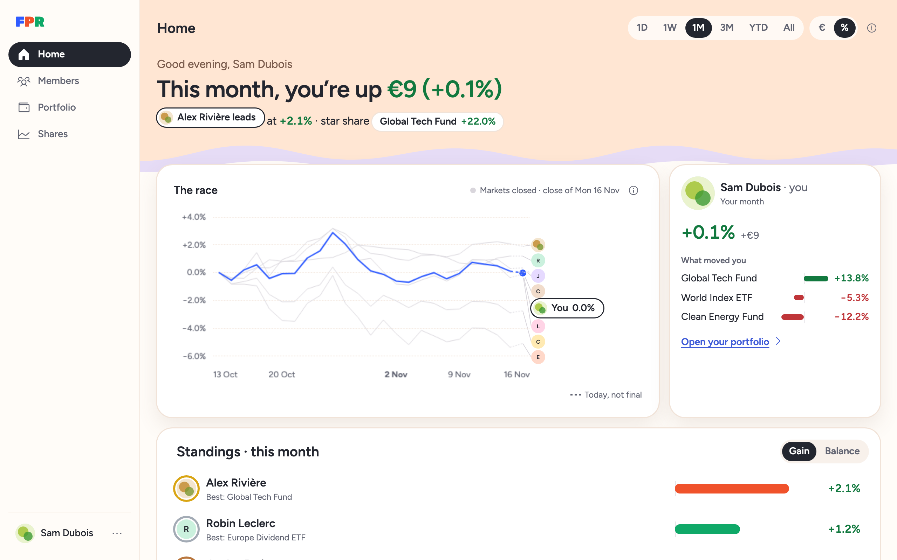
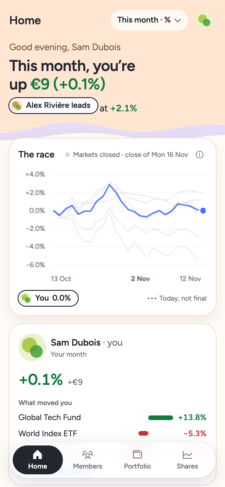
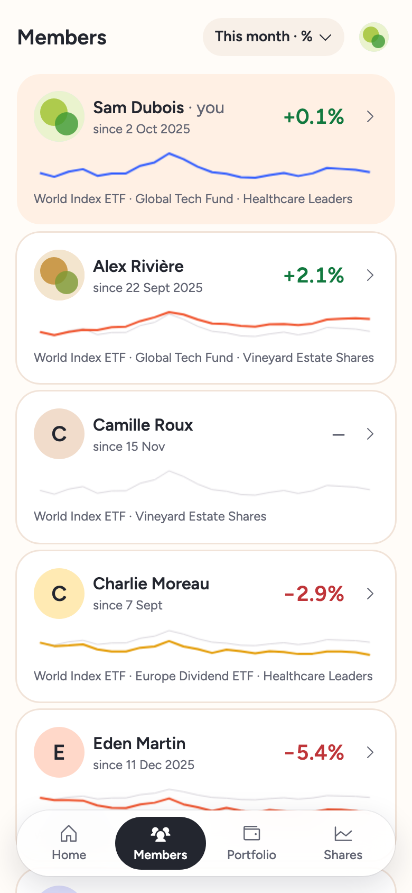
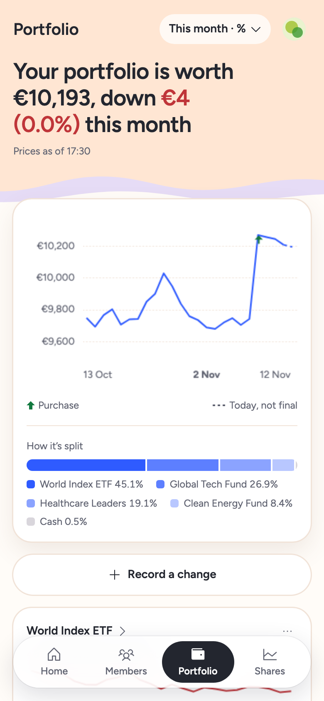
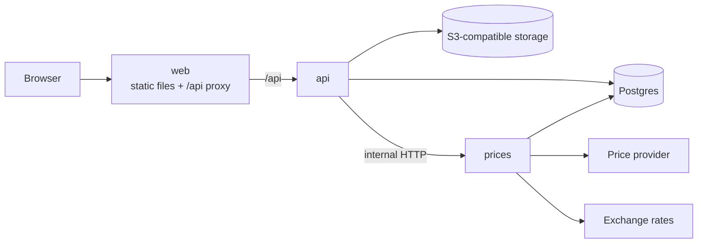

<div align="center">


# FPR

**A self-hosted leaderboard for a group's share portfolios.**

[](https://github.com/Fringhian/fpr/actions/workflows/ci.yml)


[Quick start](#quick-start) · [Self-hosting](#self-hosting) · [Architecture](#architecture) · [Documentation](#documentation)



</div>

Each member records the shares and cash they hold. FPR values every portfolio at market prices, refreshed every 30 minutes during the trading day, and ranks everyone on shared leaderboards and a race chart.

FPR is a generic tool: one Docker Compose stack with Postgres and S3-compatible storage, and every instance-specific value comes from environment variables.

## Features

- **The race**: every member's gain on one chart, with standings over 1 day, 1 week, 1 month, 3 months, year to date, or all time, in euros or in percent.
- **Portfolios**: shares and cash, with what moved each portfolio over the period and how it is split.
- **Market and manual shares**: listed shares are priced by a market data provider and converted to euros; anything else gets values entered by hand.
- **Invite only**: nobody signs up. The admin adds each person and sends them an access link, and revoking the link cuts them off.
- **Four roles**: admin, member, guest (read-only), and anonymous viewer, who sees anonymized data across the app.
- **Everywhere**: installs as a Progressive Web App on phones and computers, in English and French.

<div align="center">



</div>

<p align="center"><sub>Screenshots from <code>pnpm dev:mock</code>, with invented people and instruments.</sub></p>

## Quick start

FPR runs on Node 24 with pnpm, and its dependencies run in Docker.

### Try the app with a mock API

```sh
pnpm install
pnpm dev:mock
```

The app opens on http://localhost:5173 with an in-memory API and invented data, no Docker or `.env` needed. A switch in a corner of the page signs in as each role.

### Run the full stack

1. Install the packages. This also installs the git hooks.

   ```sh
   pnpm install
   ```

2. Copy `.env.example` to `.env` and fill it in.

   <details>
   <summary>Development values</summary>

   | Variable | Value |
   | --- | --- |
   | `POSTGRES_USER`, `POSTGRES_DB` | `fpr` |
   | `POSTGRES_PASSWORD` | Any password |
   | `DATABASE_URL` | `postgres://fpr:<POSTGRES_PASSWORD>@localhost:5432/fpr` |
   | `PUBLIC_URL` | `http://localhost:5173` |
   | `PRICES_URL` | `http://localhost:3001` |
   | `S3_ENDPOINT` | `http://localhost:9000` |
   | `S3_REGION` | `us-east-1` |
   | `S3_BUCKET` | `fpr-avatars` |
   | `S3_ACCESS_KEY_ID` | Any name |
   | `PRICE_PROVIDER` | `eodhd` |
   | `PRICE_PROVIDER_API_KEY` | Your own key at the provider, not a live instance's |
   | `LOGS_USERNAME` | Any name |
   | `PRICES_TOKEN`, `BETTER_AUTH_SECRET`, `ADMIN_BOOTSTRAP_KEY`, `PSEUDONYM_SECRET`, `S3_SECRET_ACCESS_KEY`, `LOGS_PASSWORD` | `openssl rand -hex 32`, one each |

   The other variables have defaults and can stay empty.

   </details>

3. Start Postgres, the object storage, and the logs in the background. This creates the bucket too.

   ```sh
   pnpm dev:deps
   ```

4. Create the tables, or fill an empty database with an invented race. The seed prints the shared password and the access links.

   ```sh
   pnpm db:migrate   # or: pnpm db:seed
   ```

5. Run the web app, the API, and the price service in watch mode.

   ```sh
   pnpm dev
   ```

| Service | Address |
| --- | --- |
| Web app | http://localhost:5173 |
| API | http://localhost:3000/health |
| Price service | http://localhost:3001/health |
| Logs | http://localhost:9428/select/vmui, with `LOGS_USERNAME` and `LOGS_PASSWORD` |

`docker compose --profile storage down` stops the dependencies and keeps their data.

## Self-hosting

1. Clone the repository.
2. Copy `.env.example` to `.env` and fill it in. The secrets are long random strings.
3. Run `docker compose up -d`, with `--profile storage` for local object storage.
4. Open `<PUBLIC_URL>/setup` and create the first admin with `ADMIN_BOOTSTRAP_KEY`.

The `web` service listens on the loopback port `WEB_PORT` (default `8081`), behind the host's reverse proxy, which handles TLS. The [deployment guide](docs/architecture/deployment.md) covers the services, logs, backups, CI deploys, and Coolify.

## Architecture



| Workspace | What it is |
| --- | --- |
| `apps/web` | The React app, built with Vite and served by nginx, which forwards `/api` to the API |
| `apps/api` | The only block the browser talks to: accounts, portfolios, leaderboards, and the admin area |
| `apps/prices` | The internal price service, the only block that calls the price provider and the exchange-rate API |
| `packages/contracts` | The oRPC route contracts shared by every app, and the generated OpenAPI document |
| `packages/db` | The Postgres pool, migrations, row types, and queries |

TypeScript end to end, Biome for lint and format, Vitest for tests, Storybook for components, and GitHub Actions for CI.

## Development

| Command | What it does |
| --- | --- |
| `pnpm test` | Runs every test. Tests that touch the database need `pnpm dev:deps` running |
| `pnpm typecheck` | Checks the types |
| `pnpm lint` | Checks the repository with Biome |
| `pnpm format` | Formats it and applies safe fixes |
| `pnpm db:migrate` | Applies the migrations a pull brings in |
| `pnpm storybook` | Opens Storybook on http://localhost:6006 |
| `pnpm --filter @fpr/web test-storybook` | Runs every story in Chromium with its accessibility checks, after `pnpm --filter @fpr/web exec playwright install chromium` |

Before each commit, Biome formats the staged files and blocks the commit on any lint error. Before each push, it checks the whole repository.

## Documentation

| | |
| --- | --- |
| [Overview](docs/architecture/overview.md) | The blocks, the stack, and the repository layout |
| [User stories](docs/product/user-stories.md) | What people do in FPR, with every case to cover |
| [User flows](docs/product/user-flows.md) | Every path through FPR, drawn |
| [Web](docs/architecture/web.md) | The app: screens, navigation, languages, installation |
| [API](docs/architecture/api.md) | Routes, race calculation, anonymization |
| [Price service](docs/architecture/prices.md) | Where prices come from, and when |
| [Database](docs/architecture/database.md) | Tables, keys, indexes, valuation |
| [Auth](docs/architecture/auth.md) | Roles, access links, sign-in |
| [Deployment](docs/architecture/deployment.md) | Services, self-hosting, logs, CI |
