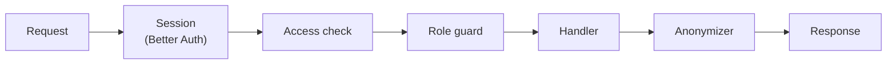

# API

`apps/api`, an Express (TypeScript) server. It is the only block the browser talks to, under `/api` on the instance's origin. It answers JSON, and every request and response body is a Zod schema in `@fpr/contracts`.

Each route is declared in `@fpr/contracts` with its method, path, schemas, error codes, and accepted roles. The OpenAPI document, `packages/contracts/openapi.json`, is generated from these declarations by `pnpm contracts:openapi`, and the API serves it with a viewer at `/api/docs` in development. The price service's internal routes are declared the same way and left out of the document.

## Request pipeline

1. **Session**: Better Auth reads the session cookie. Public routes skip the next two steps. A write whose `Origin` header isn't `PUBLIC_URL` is refused.
2. **Access check**: the person's access key still gives access. Otherwise their sessions are deleted and the answer is `401 access_ended`. See `auth.md`.
3. **Role guard**: each route declares the roles it accepts. Anonymous viewers are refused every write with `403`. Guests are refused every write except to their own profile.
4. **Handler**: validates the body with its contract, then reads and writes Postgres through `@fpr/db`.
5. **Anonymizer**: for an anonymous viewer, replaces personal data in the response. See Anonymization.

Errors are `{ "error": { "code", "details" } }`, and the web app turns the code into text in the person's language, with `400` (invalid body), `401`, `403`, `404`, `409` (conflict, such as a duplicate ISIN), or `422` (a rule refused, such as a holding below zero).

## Routes

Every role can read every member's data. A `:userId` write acts on one member's data: a member may write only their own, the admin anyone's.

The API sits behind `web`, and trusts the client address `web` forwards in `X-Forwarded-For`, so rate limits apply per real client.

### Public

| Route | Purpose |
| --- | --- |
| `/api/auth/*` | Better Auth: sign-in, sign-out, session |
| `POST /access/check` | The key's state (`waiting`, `claimed`, `expired`, `replaced`, `revoked`, `ended`, or `unknown`), and for a waiting password user their email and display name: `{ key }` |
| `POST /access/claim` | Set the password on first use: `{ key, password }` |
| `POST /access/sign-in` | An anonymous viewer's sign-in: `{ key }` |
| `POST /password-reset/check` | Page 1: `{ email, key }` is valid |
| `POST /password-reset` | Page 2: `{ email, key, password }` |
| `POST /setup` | Create the first admin with the bootstrap key. Refused with `409` once an admin exists |

### Me

| Route | Purpose |
| --- | --- |
| `GET /me` | The signed-in person: id, role, display name, picture, colour, language (empty until they pick one), and whether onboarding is finished |
| `PATCH /me` | Change the display name (1 to 40 characters), colour (1 to 10), or language, or mark onboarding finished |
| `/api/auth/change-password` | Change the password, with the current one. Ends the person's other sessions |
| `PUT /me/avatar` | Upload a picture, JPEG, PNG, or WebP up to 2 MB, stored in S3-compatible storage |
| `DELETE /me/avatar` | Go back to the initial on the person's colour |
| `GET /users/:userId/avatar` | The uploaded picture. A person without one is drawn by the web app as their initial on their colour |

A colour another person has is refused with `409`, unless all ten are taken.

### Portfolio

| Route | Purpose |
| --- | --- |
| `GET /users/:userId/portfolio?period=` | Holdings with quantity, latest value, gain over the period, and a small price series for the period; cash; total; each holding's weight; the time of the latest prices |
| `GET /users/:userId/log?limit=&before=` | Share changes and cash balances, newest first, a page at a time |
| `POST /users/:userId/changes` | Add or remove shares: `{ shareId, quantityDelta, effectiveAt }` |
| `PATCH /changes/:id`, `DELETE /changes/:id` | Edit or delete a share change |
| `POST /users/:userId/cash-balances` | Set cash: `{ amountEur, effectiveAt }` |
| `PATCH /cash-balances/:id`, `DELETE /cash-balances/:id` | Edit or delete a cash balance |
| `GET /users/:userId/balance-history?period=` | The member's balance at each close of the period, then at each refresh today, with the share changes and cash balances in the period for the chart's markers |

Every write to `portfolio_changes` runs in one transaction that takes a per-user advisory lock, then checks that no holding of that member goes below zero at any moment. A refusal names the entry it would break. A change that makes a market share held for the first time, or is dated before its stored history, is saved first, then the API asks the price service for that history without waiting. See `prices.md`.

### Shares

| Route | Purpose |
| --- | --- |
| `GET /shares?q=&period=` | Stored shares matching a name, ISIN, or symbol, read from Postgres, each with its latest price, change over the period, a small price series, and its holders. With an empty query, every stored share, held ones first |
| `POST /shares/lookup` | Look up an ISIN or ticker at the provider, through the price service: `{ query }`. Returns the matching shares, stored |
| `POST /shares/manual` | Create a manual share, through the price service: `{ isin, name, priceEur, at }` |
| `GET /shares/:id?period=` | A share's details, latest price with its time, change over the period, and the signed-in member's position: quantity, value, and gain since they bought, each purchase valued at that day's price |
| `GET /shares/:id/prices?range=` | Chart points for `1D`, `1W`, `1M`, `3M`, `YTD`, or `all`: intraday points for `1D` and `1W`, daily closes otherwise |
| `GET /shares/:id/holders` | Each member's changes on this share, for the chart markers, and their result on it |
| `GET /shares/:id/values` | A manual share's value points, newest first, each with who entered it |
| `GET /shares/:id/value-events` | A manual share's value edits, newest first: who changed which value, from what to what |
| `PATCH /shares/:id` | Edit a manual share's name or ISIN: `{ name, isin }`. An ISIN another share already has is refused |
| `POST /shares/:id/values` | Add a value point to a manual share: `{ at, priceEur }` |
| `PATCH /shares/:id/values/:at`, `DELETE …` | Edit a value point's price, or delete it: `{ priceEur, expectedPriceEur }`. Refused with `409` and the stored value when it is no longer `expectedPriceEur`, so a second editor confirms over the first |
| `DELETE /shares/:id` | Admin only, through the price service. Delete a share no share change refers to, with its prices. Refused with `409` otherwise |

Any member and the admin can edit a manual share and its value points.

No share route calls the provider except `POST /shares/lookup`. Everything else reads Postgres.

### Race

| Route | Purpose |
| --- | --- |
| `GET /leaderboards/:board?period=&unit=` | `balance`, or `gain` over `1D`, `1W`, `1M`, `3M`, `YTD`, or `all` in `eur` or `percent`, as of the last close. Each row carries the member's best holding over the period |
| `GET /leaderboards/shares?period=` | The shares held in the race, ranked by their change over the period |
| `GET /members?period=&unit=` | Every member with the date of their first entry, their series over the period, their gain and balance, and their top three holdings with weights |
| `GET /race?period=&unit=` | Every member's gain since the period's start at each close, then at each refresh since the last close, in `eur` or `percent`. The points after the last close are marked provisional. Also returns the time of the latest prices and whether today's refreshes are running |

### Admin

| Route | Purpose |
| --- | --- |
| `GET /admin/people` | Every person, their role, and their access status |
| `POST /admin/people` | Add a person. Returns the access link once |
| `PATCH /admin/people/:id` | Change a person's display name, email, role, or access end date |
| `POST /admin/people/:id/revoke`, `/restore` | Revoke or restore access |
| `POST /admin/people/:id/replace-link` | Replace the access link. Returns the new link once |
| `POST /admin/people/:id/reset-key` | Generate a reset key. Returns it once |
| `DELETE /admin/people/:id` | Delete a person and their data |
| `GET /admin/shares` | Every stored share in one group: needs attention (held, with no price or a latest close older than the last trading day), tracked, manual, or not held, with the time of its latest price, its holders, and whether any share change refers to it |
| `POST /admin/shares/:id/make-manual` | Turn a market share that needs attention into a manual share, through the price service: `{ priceEur, at }` when it has no price yet. Refused with `409` for any other share |
| `POST /admin/prices/refresh` | Run the price refresh now, through the price service. Refused with `409` while a run is going, and `429` once the day's call cap is reached |

Anonymous viewers may read `GET /admin/people` and `GET /admin/shares`.

Role changes move between `admin`, `member`, and `guest`. A person with portfolio entries can't become a guest, the last admin can't stop being one, and nobody becomes or stops being `anonymous`.

## Race calculation

Leaderboards and the race chart come from one series per member: their balance at each day's close from their first entry, then their balance at each intraday refresh since the last close. A balance is each holding × the share's latest price at that moment, plus cash. The series is computed in Postgres from `portfolio_changes`, `cash_balances`, and `prices`.

- **Balance**: the value of the series at the last close.
- **Gain**: the value at the last close minus the value at the period's start, in euros, or divided by the value at the period's start, in percent.
- Leaderboards use closes only. The intraday points serve the race chart's current day, portfolios, and share pages.
- **A holding's gain over a period**: its value at the end, minus its value at the start, minus the value of the shares added during the period, plus the value of the shares removed, each valued at its day's price. It feeds "what moved" a member and each holding card.
- **Gain since bought**: a holding's value minus its cost. Each purchase costs its quantity × the share's price on its day; a sale removes cost at the holding's average cost.

A member whose first entry is after the period's start is measured from their first entry, with a marker. A member with no entries is listed as not started. A member holding a share with no price yet is ranked on the shares that have one, with an "incomplete" marker. The series is cached in memory. The API clears it on every write it makes or forwards (portfolio changes, cash balances, manual shares and values), and each request recomputes it when the latest `created_at` in `prices` has changed since, which catches the scheduled runs.

## Anonymization

For an anonymous viewer, the anonymizer replaces, in every response:

- display names with pseudonyms, and photos with nothing, so the web app draws the pseudonym's initial on the person's colour;
- emails with nothing;
- euro amounts with percentages, and euro series with series in percent;
- quantities held with each holding's weight in percent of the portfolio, and cash with its weight too.

The balance leaderboard shows ranks without amounts. Share prices are market data and stay in euros.

A pseudonym is an adjective and an animal, picked with `HMAC-SHA256(PSEUDONYM_SECRET, userId)`. Two people with the same pseudonym are told apart by a number suffix. It is the same on every screen and visit, and is not stored.

The anonymizer works on the contract's fields: each schema in `@fpr/contracts` marks its personal and euro fields, and a test fails when a schema has an unmarked field of those kinds.

## Configuration

| Variable | Purpose |
| --- | --- |
| `PORT` | The port it listens on. Default `3000` |
| `DATABASE_URL` | Postgres |
| `PUBLIC_URL` | The instance's origin, used for links and the origin check |
| `BETTER_AUTH_SECRET` | Session signing |
| `ADMIN_BOOTSTRAP_KEY` | The first admin's setup key |
| `PSEUDONYM_SECRET` | Pseudonyms |
| `PRICES_URL`, `PRICES_TOKEN` | The price service |
| `S3_ENDPOINT`, `S3_REGION`, `S3_BUCKET`, `S3_ACCESS_KEY_ID`, `S3_SECRET_ACCESS_KEY` | Picture storage |
| `RACE_TIMEZONE` | Where a day starts. Default `Europe/Paris` |
