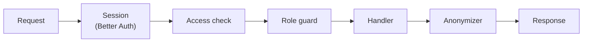

# API

`apps/api`, an Express (TypeScript) server. It is the only block the browser talks to, under `/api` on the instance's origin. It answers JSON, and every request and response body is a Zod schema in `@fpr/contracts`.

## Route contracts

Each route is an oRPC contract in `@fpr/contracts`. `apiContract` holds every API route, one key per area, each area in its folder under `src/api/`: `access`, `me`, `portfolio`, `shares`, `race`, and `admin`. A route's key is its area and its name, such as `me.get`, and the OpenAPI document uses it as the operation id and the area as its tag. The price service's internal routes are in `src/prices/`, in `pricesContract`.

The package has three entry points:

| Entry point | Holds | Used by |
| --- | --- | --- |
| `@fpr/contracts` | `apiContract`, the types of each route's input and output, the shared schemas, the error codes, the roles, and the helpers that declare a route | the web app, the API, and the price service |
| `@fpr/contracts/prices` | `pricesContract` and the types of its routes | the API and the price service |
| `@fpr/contracts/openapi` | `createOpenApiDocument`, oRPC's generator | the API's `/api/docs`, and `pnpm contracts:openapi` |

A test fails when the root entry point loads the price service's routes or the generator. A route is reached through its tree, such as `apiContract.race.leaderboard`, and is not exported on its own. Its schemas stay in its file, which exports their types under short names, such as `Leaderboard` for the response and `LeaderboardQuery` for the input. A schema becomes shared, in `src/schemas/`, once a second area uses it.

A contract starts from `publicRoute`, or from `signedInRoute(roles)` with the roles it accepts, and declares:

- its method, its path under `/api` with `{params}`, such as `/users/{userId}/portfolio`, and a one-line summary, with `.route()`;
- its input, with `.input()`: the path params, the query, and the body in one Zod object;
- its response, with `.output()`;
- its error codes, with `.errors(errorMap(...))`, each sent with its status, and a code whose `details` follow a schema with `.errors(errorWithDetails(code, schema))`.

Each definition has one source:

- `src/roles.ts` holds the roles, `Role` to name one, such as `Role.admin`, and the role lists routes share: `adminRoles`, `adminAreaRoles`, `writerRoles`, and `profileRoles`.
- A list of values, such as the units, the boards, or the access key states, is defined once with `z.enum`, and a field or discriminant that takes one of its values references it, such as `accessKeyStateSchema.enum.waiting`. A test fails when a value of a shared list is written as a string outside the file that defines it.
- `src/schemas/` holds the schemas several areas share, one file per theme: ids and moments; a person, their email and display name; passwords, access keys, and reset keys; currencies, prices, and percentages; shares, their names, listings, lookups, and latest prices; and the markers and amounts of a member's performance. The API's routes and the price service's use the same schemas and the same names.

Every route declares the codes the request pipeline can answer it with: `internal_error` always, `invalid_request` when it has an input, `unauthenticated` and `access_ended` when it isn't public, and `forbidden` for a write, or for a route that refuses a role. `publicRoute` and `signedInRoute` carry the first ones. Tests over every route of `apiContract` and `pricesContract` fail when a route misses one of those codes, when a parameter of its path isn't a required field of its input, or when two routes share a method and path. Each route's tests cover what its schemas accept and refuse. The committed OpenAPI document is the record of each route's method, path, roles, and codes, reviewed in each change's diff.

The API implements the contracts with oRPC's server, mounted on Express under `/api`. oRPC validates each input and output with its schema. Errors keep the format of Errors below: a declared code is sent as it is, a failed input validation as `invalid_request` with its issues in `details`, and anything else as `internal_error`, logged with its stack. A path no contract matches goes on to Express, which answers `not_found`.

The OpenAPI 3.1 document, `packages/contracts/openapi.json`, is generated from the contracts by oRPC's generator and `pnpm contracts:openapi`. `pnpm contracts:openapi --check` fails when the file is not up to date, and CI runs it. Each operation lists its roles in `x-roles`, and each field the anonymizer replaces carries `x-anonymize`. Each error response has one body per code, with the typed `details` of a code declared with `errorWithDetails`, and the details of `invalid_request` under `components` as `InvalidRequestDetails`. A response without a body, such as a `204`, has no content. In development, the API serves the document at `/api/docs/openapi.json` and the Scalar viewer at `/api/docs`. The price service's internal routes are declared the same way and left out of the document.

## Request pipeline

1. **Session**: Better Auth reads the session cookie. Public routes skip the next two steps. A write whose `Origin` header isn't `PUBLIC_URL` is refused.
2. **Access check**: the person's access key still gives access. Otherwise their sessions are deleted and the answer is `401 access_ended`. See `auth.md`.
3. **Role guard**: each route declares the roles it accepts. Anonymous viewers are refused every write with `403`. Guests are refused every write except to their own profile.
4. **Handler**: receives the input oRPC validated with its contract, then reads and writes Postgres through `@fpr/db`.
5. **Anonymizer**: for an anonymous viewer, replaces personal data in the response. See Anonymization.

## Errors

Errors are `{ "error": { "code", "details" } }`, and the web app turns the code into text in the person's language. `details` is an object, present when the code carries more, such as the entry a refused change would break or the stored value a stale edit missed. `@fpr/contracts` holds the codes and the status each one is sent with:

| Status | Code | When |
| --- | --- | --- |
| `400` | `invalid_request` | The body, query, or path fails its schema. `details` lists the issues, `{ issues: [{ path, code }] }`: each field's path in the input, such as `["amountEur"]`, and Zod's issue code, such as `too_small` or `invalid_format`, without its text |
| `401` | `unauthenticated` | No session, or it expired |
| `401` | `access_ended` | The person's key no longer gives access. See `auth.md` |
| `403` | `forbidden` | The role can't do this, the data belongs to another member, or the `Origin` isn't `PUBLIC_URL` |
| `404` | `not_found` | No such route, person, share, entry, or value point |
| `409` | `admin_exists` | `POST /setup` once an admin exists |
| `409` | `color_taken` | Another person has the colour, and not all ten are taken |
| `409` | `email_taken` | Another person has the email |
| `409` | `isin_taken` | Another share has the ISIN. `details` has that share's id, `{ shareId }` |
| `409` | `share_in_use` | Deleting a share a share change refers to |
| `409` | `share_not_needing_attention` | Making manual a share that doesn't need attention |
| `409` | `value_changed` | A value point is no longer `expectedPriceEur`, or one already exists at the moment a new one is added. `details` has the stored price, `{ priceEur }` |
| `409` | `refresh_running` | A price refresh while a run is going |
| `413` | `avatar_too_large` | A picture over 2 MB |
| `415` | `avatar_type_unsupported` | A picture that isn't JPEG, PNG, or WebP |
| `422` | `invalid_access_key` | Claiming a key that isn't waiting, or signing in with one that doesn't give access, or with a key of the other kind of person. `details` has its state, `{ state }` |
| `422` | `invalid_reset_key` | A wrong, used, or expired email and reset key pair, without saying which |
| `422` | `invalid_bootstrap_key` | `POST /setup` with a key other than `ADMIN_BOOTSTRAP_KEY` |
| `422` | `holding_below_zero` | A change, edit, or deletion that takes a holding below zero. `details` names the entry it would break |
| `422` | `future_moment` | A share change, cash balance, or value point dated in the future |
| `422` | `last_admin` | Revoking, ending, replacing, deleting, or changing the role of the last admin |
| `422` | `has_portfolio_entries` | Making a guest of a person with portfolio entries |
| `422` | `anonymous_role_fixed` | Making someone anonymous, or an anonymous viewer something else |
| `422` | `last_value_point` | Deleting a manual share's only value point |
| `429` | `rate_limited` | Too many requests from one client |
| `429` | `call_budget_used` | A lookup or refresh once the day's provider calls are used |
| `500` | `internal_error` | An unexpected failure, logged with its request id |
| `503` | `provider_unavailable` | A lookup while the price provider doesn't answer |

## Routes

Every role can read every member's data. A `:userId` write acts on one member's data: a member may write only their own, the admin anyone's.

The API sits behind `web`, and trusts the client address `web` forwards in `X-Forwarded-For`, so rate limits apply per real client.

### Public

| Route | Purpose |
| --- | --- |
| `/api/auth/*` | Better Auth: sign-in, sign-out, session |
| `POST /access/check` | The key's state (`waiting`, `claimed`, `expired`, `replaced`, `revoked`, `ended`, or `unknown`), and for a known key whether its person signs in with a `password` or the `link`. For a waiting password user, also their email, display name, and whether they already have a password: `{ key }` |
| `POST /access/claim` | Claim a password user's waiting key: `{ key, password }`, without `password` when the person already has one. Answers whether a session started: it starts when the claim sets the password, and a person who already had one signs in with it |
| `POST /access/sign-in` | An anonymous viewer's sign-in: `{ key }` |
| `POST /password-reset/check` | Page 1: `{ email, key }` is valid |
| `POST /password-reset` | Page 2: `{ email, key, password }` |
| `GET /setup` | Whether an admin exists, which closes `/setup` |
| `POST /setup` | Create the first admin with the bootstrap key: `{ bootstrapKey, email, displayName, password }`. Refused with `409` once an admin exists |

Every write here is rate-limited per client address.

### Me

| Route | Purpose |
| --- | --- |
| `GET /me` | The signed-in person: id, role, display name, picture, colour, language (empty until they pick one), and whether onboarding is finished |
| `PATCH /me` | Change the display name (1 to 40 characters), colour (1 to 10), or language, or mark onboarding finished |
| `/api/auth/change-password` | Change the password, with the current one. Ends the person's other sessions |
| `PUT /me/avatar` | Upload a picture, JPEG, PNG, or WebP up to 2 MB, as the raw request body with its media type. Stored in S3-compatible storage |
| `DELETE /me/avatar` | Go back to the initial on the person's colour |
| `GET /users/:userId/avatar` | The uploaded picture. A person without one is drawn by the web app as their initial on their colour |

A colour another person has is refused with `409`, unless all ten are taken. `PATCH /me`, `PUT /me/avatar`, and `DELETE /me/avatar` answer the person as `GET /me` does. Anonymous viewers see no photos: `GET /users/:userId/avatar` refuses them with `403`.

### Portfolio

| Route | Purpose |
| --- | --- |
| `GET /users/:userId/portfolio?period=` | Each holding's position (quantity, value, weight, and gain over the period), latest price, and a small price series for the period; the holdings' value and the cash, each with its weight; the balance; its gain over the period; `latestPricesAt`, the time of the latest prices; `firstEntryOn`, `measuredFrom`, and `incomplete` |
| `GET /users/:userId/holdings/:shareId?at=` | The quantity of a share the member held at a moment, zero when they held none: `{ share, at, quantity }`. `at` is a timestamp with its offset. A sale shows it before its quantity is typed. `404` for an unknown person or share |
| `GET /users/:userId/log?limit=&before=` | Share changes and cash balances, newest first, a page at a time: `limit` entries, 50 by default and 100 at most, after the `before` cursor the previous page returned |
| `POST /users/:userId/changes` | Add or remove shares: `{ id, shareId, quantityDelta, effectiveAt }`. `quantityDelta` is above zero for a purchase, below zero for a sale, and never zero. `id` is optional |
| `PATCH /changes/:id`, `DELETE /changes/:id` | Edit a share change's quantity or moment, `{ quantityDelta, effectiveAt }`, or delete it |
| `POST /users/:userId/cash-balances` | Set cash: `{ id, amountEur, effectiveAt }`, with `amountEur` zero or more. `id` is optional |
| `PATCH /cash-balances/:id`, `DELETE /cash-balances/:id` | Edit a cash balance's amount or moment, `{ amountEur, effectiveAt }`, or delete it |
| `GET /users/:userId/balance-history?period=` | The member's points at each close of the period, then at each refresh today, each with the balance and the gain since the period's start, with the share changes and cash balances in the period for the chart's markers |

The `id` of `POST /users/:userId/changes` and `POST /users/:userId/cash-balances` is a UUID the client generates for the entry it creates. A request repeating an `id` already stored for that person answers the stored entry as it is, with `201`, and creates nothing, so a save sent twice is saved once. An `id` another person's entry has is refused with `403`. Without an `id`, the API generates one.

Every write to `portfolio_changes` runs in one transaction that takes a per-user advisory lock, then checks that no holding of that member goes below zero at any moment. A refusal, `holding_below_zero`, names the entry it would break in `details`: the stored share change the holding would go below zero at, or `null` for the change sent, and the quantity held just before it. The portfolio routes answer `not_found` for a person with no portfolio: a guest or an anonymous viewer. A change that makes a market share held for the first time, or is dated before its stored history, is saved first, then the API asks the price service for that history without waiting. See `prices.md`.

### Shares

| Route | Purpose |
| --- | --- |
| `GET /shares?q=&period=` | Stored shares matching a name, ISIN, or symbol, read from Postgres, each with its latest price, change over the period in euros and in percent, a small price series, and its holders. With an empty query, every stored share, held ones first |
| `POST /shares/lookup` | Look up an ISIN or ticker at the provider, through the price service's `POST /lookup`: `{ query }`, 1 to 100 characters. Returns `{ shares, listings }`: the matching shares, stored, and the listings the provider returned without an ISIN. `{ query, isin }`, with a listing's symbol as `query`, is forwarded to the price service's `POST /shares/market`, which stores that listing under the ISIN the member typed, and returns it in `shares`. Refused with `404` when the provider no longer returns the symbol, and `409` when another share has the ISIN |
| `POST /shares/manual` | Create a manual share, through the price service: `{ isin, name, priceEur, at }` |
| `GET /shares/:id?period=` | A share's details, latest price with its time and source, change over the period in euros and in percent, and the signed-in member's position: quantity, value, weight in their balance, and gain since they bought, each purchase valued at that day's price |
| `GET /shares/:id/prices?range=` | Chart points for `1D`, `1W`, `1M`, `3M`, `YTD`, or `all`: intraday points for `1D` and `1W`, daily closes otherwise |
| `GET /shares/:id/holders` | Each member's changes on this share, for the chart markers, and their position on it, with its gain since they bought |
| `GET /shares/:id/values` | A manual share's value points, newest first, each with who entered it |
| `GET /shares/:id/value-events` | A manual share's value edits, newest first: who changed which value, from what to what |
| `PATCH /shares/:id` | Edit a manual share's name or ISIN: `{ name, isin }`. An ISIN another share already has is refused |
| `POST /shares/:id/values` | Add a value point to a manual share: `{ at, priceEur }` |
| `PATCH /shares/:id/values/:at`, `DELETE …` | Edit a value point's price, `{ priceEur, expectedPriceEur }`, or delete it, `{ expectedPriceEur }`. Refused with `409` and the stored value when it is no longer `expectedPriceEur`, so a second editor confirms over the first |
| `DELETE /shares/:id` | Admin only, through the price service. Delete a share no share change refers to, with its prices. Refused with `409` otherwise |

Any member and the admin can edit a manual share and its value points.

- `:at` is the value point's moment as `GET /shares/:id/values` returns it, an ISO 8601 timestamp with its offset, percent-encoded as one path segment: `/shares/:id/values/2026-03-02T16%3A30%3A00Z`. The API matches the instant, so `2026-03-02T17:30:00+01:00` names the same value point.
- A manual share's name is 1 to 100 characters, trimmed, and each value is above zero, as in the price service.
- A market share has no value points: its value lists are empty, and editing its name, ISIN, or values answers `404`.
- A position is the same in a portfolio, on a share's page, and among its holders: `{ quantity, valueEur, weight, gain }`, its gain over the period in a portfolio and since bought on a share. Its quantity and euro amounts are marked for the anonymizer. Share prices, changes, and value points are not.

No share route calls the provider except `POST /shares/lookup`. Everything else reads Postgres.

### Race

| Route | Purpose |
| --- | --- |
| `GET /leaderboards/:board?period=&unit=` | `balance`, or `gain` over `1D`, `1W`, `1M`, `3M`, `YTD`, or `all`, as of the last close. Each row carries the member's best holding over the period, with its gain |
| `GET /leaderboards/shares?period=` | The shares held in the race, ranked by their change in percent over the period, each with its change in euros and in percent |
| `GET /members?period=` | Every member with the date of their first entry, their points since the period's start at each close, their gain and balance, and their top three holdings with weights |
| `GET /race?period=` | Every member's points since the period's start at each close, then at each refresh since the last close. The points after the last close are marked provisional. Also returns `latestPricesAt`, the time of the latest prices, and whether today's refreshes are running |

Every gain carries euros and percent, `{ eur, percent }`, and a member's point carries their balance and their gain, so the web app draws the unit the viewer picks without a new request. `unit` decides an order only: the gain leaderboard ranks by the gain in `eur` or in `percent`, `eur` when left out, and names the unit it ranked by. The balance leaderboard ranks by balance and has no unit. An anonymous viewer is ranked in `percent`, whatever `unit` asks.

### Admin

| Route | Purpose |
| --- | --- |
| `GET /admin/people` | Every person, their role, and their access status: `waiting`, `active`, `expired`, `revoked`, or `ended` |
| `POST /admin/people` | Add a person. Returns the access link once |
| `PATCH /admin/people/:id` | Change a person's display name, email, role, or access end date |
| `POST /admin/people/:id/revoke`, `/restore` | Revoke or restore access |
| `POST /admin/people/:id/replace-link` | Replace the access link. Returns the new link once |
| `POST /admin/people/:id/reset-key` | Generate a reset key. Returns it once |
| `DELETE /admin/people/:id` | Delete a person and their data |
| `GET /admin/shares` | Every stored share in one group: needs attention (held, with no price or a latest close older than the last trading day), tracked, manual, or not held, with its latest price, its time, and its source, its holders, and whether any share change refers to it |
| `POST /admin/shares/:id/make-manual` | Turn a market share that needs attention into a manual share, through the price service: `{ priceEur, at }` when it has no price yet. Refused with `409` for any other share |
| `POST /admin/prices/refresh` | Run the price refresh now, through the price service. Refused with `409` while a run is going, and `429` once the day's call cap is reached |

Anonymous viewers may read `GET /admin/people` and `GET /admin/shares`.

Role changes move between `admin`, `member`, and `guest`. A person with portfolio entries can't become a guest, the last admin can't stop being one, and nobody becomes or stops being `anonymous`.

## Race calculation

Leaderboards and the race chart come from one series per member: their balance at each day's close from their first entry, then their balance at each intraday refresh since the last close. A balance is each holding × the share's latest price at that moment, plus cash. The series is computed in Postgres from `portfolio_changes`, `cash_balances`, and `prices`.

- **Balance**: the value of the series at the last close.
- **Gain**: the value at the last close minus the value at the period's start, in euros, or divided by the value at the period's start, in percent.
- Leaderboards use closes only. The intraday points serve the race chart's current day, portfolios, and share pages.
- **A holding's gain over a period**: its value at the end, minus its value at the start, minus the value of the shares added during the period, plus the value of the shares removed, each valued at its day's price. It feeds "what moved" a member and each holding card.
- **Gain since bought**: a holding's value minus its cost. Each purchase costs its quantity × the share's price on its day; a sale removes cost at the holding's average cost.

A member whose first entry is after the period's start is measured from their first entry, with a marker. A member with no entries is listed as not started. A member holding a share with no price yet is ranked on the shares that have one, with an "incomplete" marker. The series is cached in memory. The API clears it on every write it makes or forwards (portfolio changes, cash balances, manual shares and values), and each request recomputes it when the latest `created_at` in `prices` has changed since, which catches the scheduled runs.

## Anonymization

For an anonymous viewer, the anonymizer replaces, in every response:

- display names with pseudonyms, and photos with nothing, so the web app draws the pseudonym's initial on the person's colour;
- emails with nothing;
- every amount in euros with nothing: the percentage beside it stays;
- quantities held with each holding's weight in percent of the portfolio, and cash with its weight too.

Every amount in euros has its percentage beside it: a gain is `{ eur, percent }`, a holding's `valueEur` has its `weight`, and the holdings' value and the cash have theirs. A member's total balance has no percentage, so anonymous viewers see ranks without amounts, and draw a member's curve from the gain in percent. Share prices, their changes, and value points are market data and stay in euros. A test fails when a response has an amount in euros without its percentage, a balance aside.

The gain leaderboard ranks an anonymous viewer in `percent`, whatever `unit` asks.

A pseudonym is an adjective and an animal, picked with `HMAC-SHA256(PSEUDONYM_SECRET, userId)`. Two people with the same pseudonym are told apart by a number suffix. It is the same on every screen and visit, and is not stored.

The anonymizer works on the contract's fields: each schema in `@fpr/contracts` marks its fields with `personal()` (names, pictures, emails), `euro()` (amounts in euros), or `quantity()` (quantities held and cash). A test over every response of `apiContract` fails when a field's mark doesn't fit its name: `email`, `displayName`, and `avatarUrl` are `personal`; `quantity…`, `cash…`, and `amountEur` are `quantity`; another `eur` or `…Eur` is `euro` or `quantity`; and `percent`, `…Percent`, `weight`, and `…Weight` are unmarked. A share's prices, `priceEur` and `previousPriceEur`, and a share's price change are market data, listed in the test as exceptions, and stay unmarked.

## Configuration

| Variable | Purpose |
| --- | --- |
| `PORT` | The port it listens on. Default `3000` |
| `DATABASE_URL` | Postgres |
| `PUBLIC_URL` | The instance's origin, used for links and the origin check |
| `BETTER_AUTH_SECRET` | Session signing |
| `ADMIN_BOOTSTRAP_KEY` | The first admin's setup key |
| `PSEUDONYM_SECRET` | Pseudonyms |
| `PRICES_URL`, `PRICES_TOKEN` | The price service |
| `S3_ENDPOINT`, `S3_REGION`, `S3_BUCKET`, `S3_ACCESS_KEY_ID`, `S3_SECRET_ACCESS_KEY` | Picture storage |
| `RACE_TIMEZONE` | Where a day starts. Default `Europe/Paris` |
