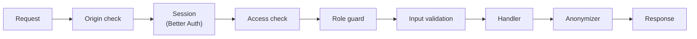

# API

`apps/api`, an Express server and the only block the browser talks to, under `/api` on the instance's origin. It answers JSON, implements the route contracts of `@fpr/contracts` with oRPC's server, and reads and writes Postgres through `@fpr/db`. Better Auth runs inside it: see `auth.md`.

## Route contracts

Every route is an oRPC contract in `packages/contracts`. `apiContract` holds the API's routes, one folder per area under `src/api/`: `access`, `me`, `portfolio`, `shares`, `race`, and `admin`. `pricesContract`, in `src/prices/`, holds the price service's internal routes.

| Entry point | Holds | Used by |
| --- | --- | --- |
| `@fpr/contracts` | `apiContract`, the shared schemas, the error codes, and the roles | web, API, price service |
| `@fpr/contracts/prices` | `pricesContract` | API, price service |
| `@fpr/contracts/openapi` | The OpenAPI generator | the API's `/api/docs`, `pnpm contracts:openapi` |
| `@fpr/contracts/values` | The plain lists and patterns the schemas are built from, with no Zod or oRPC | web |

A contract declares who may call it, its method and path under `/api`, its input (path params, query, and body in one Zod object), its output, and its error codes. It starts from `publicRoute` or from `signedInRoute(roles)`: a route that declares neither fails to type-check, and the API refuses it with `403 forbidden`.

- Roles and the role lists routes share live in `src/roles.ts`.
- A list of values is defined once, and its `z.enum` and every use reference it. The lists the web app reads (periods, units, languages, boards, share kinds, price sources) live in `src/values.ts`; the others, such as the access key states, in their route's file.
- A schema stays in its route's file until a second area uses it, then moves to `src/schemas/`. The API's and the price service's routes share these schemas under the same names.

Tests over every route of both contracts fail when:

- a route misses a code the request pipeline can answer it with: `internal_error` always, `invalid_request` with an input, `unauthenticated` and `access_ended` when signed in, `forbidden` for a write or a route that refuses a role;
- a path parameter isn't a required field of the input, or two routes share a method and path;
- a route other than setup, the access link routes, and password reset is public;
- a write accepts anonymous viewers, or accepts guests outside `/me`;
- a value of a shared list is written as a string outside the file that defines it;
- `@fpr/contracts` loads the price service's routes or the generator.

The OpenAPI 3.1 document, `packages/contracts/openapi.json`, is generated from `apiContract` by `pnpm contracts:openapi` and committed, so each change's diff shows its routes, roles, and codes. CI runs `pnpm contracts:openapi --check`, which fails when the file is out of date. Each operation lists its roles in `x-roles`, and each field the anonymizer replaces carries `x-anonymize`. In development, the API serves it at `/api/docs/openapi.json` with the Scalar viewer at `/api/docs`.

## Request pipeline

1. **Origin check**: a write, any method but `GET` and `HEAD`, whose `Origin` isn't `PUBLIC_URL`'s origin, or that has none, is `403 forbidden`, public routes included.
2. **Session**: Better Auth reads the session cookie. Without a session, the answer is `401 unauthenticated`. A session extended on use sends its renewed cookie.
3. **Access check**: when the person's access key no longer gives access, every session of the person is deleted and the answer is `401 access_ended`. See `auth.md`, Access keys.
4. **Role guard**: a role the route doesn't list is `403 forbidden`, and so is every write by an anonymous viewer.
5. **Input validation**: a failure is `400 invalid_request`.
6. **Handler**: a write to one person's data is allowed to that person and the admin, and `403 forbidden` for anyone else. Validation runs first, so an invalid body to another person's data is `400`.
7. **Anonymizer**: for an anonymous viewer, replaces personal data in the response. See Anonymization.

Public routes skip the session, access check, and role guard, and their handlers have no signed-in person. The first four steps live in `apps/api/src/pipeline/`. The request log line carries the signed-in person's id.

## Errors

Every error is `{ "error": { "code", "details" } }`. The web app turns the code into text in the person's language. `details` is an object, present when the code carries more. An error a route doesn't declare is sent as `internal_error` and logged with its stack. A path no route matches is `not_found`. `@fpr/contracts` holds each code and its status:

| Status | Code | When |
| --- | --- | --- |
| `400` | `invalid_request` | The input fails its schema. `details`: `{ issues: [{ path, code }] }`, each field's path and Zod's issue code, without text |
| `401` | `unauthenticated` | No session, or it expired |
| `401` | `access_ended` | The person's key no longer gives access |
| `403` | `forbidden` | The role can't do this, the data belongs to someone else, or the `Origin` is wrong |
| `404` | `not_found` | No such route, person, share, entry, or value point |
| `409` | `admin_exists` | `POST /setup` once an admin exists |
| `409` | `color_taken` | Another person has the colour, and not all ten are taken |
| `409` | `email_taken` | Another person has the email |
| `409` | `isin_taken` | Another share has the ISIN. `details`: `{ shareId }` |
| `409` | `share_in_use` | Deleting a share a share change refers to |
| `409` | `share_not_needing_attention` | Making manual a share that doesn't need attention |
| `409` | `value_changed` | A value point isn't the expected value, or one exists at that moment. `details`: `{ priceEur }` |
| `409` | `refresh_running` | A price refresh while a run is going |
| `413` | `avatar_too_large` | A picture over 2 MB |
| `415` | `avatar_type_unsupported` | A picture that isn't JPEG, PNG, or WebP |
| `422` | `invalid_access_key` | A key that isn't waiting, doesn't give access, or is for the other kind of person. `details`: `{ state }` |
| `422` | `invalid_reset_key` | A wrong, used, or expired email and reset key pair |
| `422` | `invalid_bootstrap_key` | `POST /setup` with the wrong bootstrap key |
| `422` | `holding_below_zero` | A change, edit, or deletion that takes a holding below zero. `details` names the entry it breaks |
| `422` | `future_moment` | A share change, cash balance, or value point dated in the future |
| `422` | `last_admin` | Revoking, ending, replacing, deleting, or demoting the last admin |
| `422` | `has_portfolio_entries` | Making a guest of a person with portfolio entries |
| `422` | `anonymous_role_fixed` | Making someone anonymous, or an anonymous viewer something else |
| `422` | `last_value_point` | Deleting a manual share's only value point |
| `429` | `rate_limited` | Too many requests from one client address |
| `429` | `call_budget_used` | A lookup or refresh once the day's provider calls are used |
| `500` | `internal_error` | An unexpected failure, logged with its request id |
| `503` | `provider_unavailable` | A lookup while the price provider doesn't answer |

## Routes

Every role reads every member's data. A write to one person's data is allowed to that person and the admin. The contracts and the OpenAPI document hold each route's fields.

Who may call: **public** (no session), **all** (every signed-in role), **profile** (all but anonymous), **writers** (admin and member), **admin**, and **admin area** (the admin, and anonymous viewers read-only).

### Access

| Route | Who | What |
| --- | --- | --- |
| `/api/auth/*` | public | Better Auth: password sign-in, sign-out, session, password change |
| `POST /access/check` | public | A key's state, and who it is for while waiting |
| `POST /access/claim` | public | Claim a password user's waiting key, setting the password on first use |
| `POST /access/sign-in` | public | Sign an anonymous viewer in with their key |
| `POST /password-reset/check`, `POST /password-reset` | public | Check an email and reset key pair, then set the new password |
| `GET /setup`, `POST /setup` | public | Whether an admin exists; create the first admin with the bootstrap key |

Every public write is rate-limited per client address: see `auth.md`.

### Me

| Route | Who | What |
| --- | --- | --- |
| `GET /me` | all | The signed-in person: role, display name, picture, colour, language, onboarding |
| `PATCH /me` | profile | Change display name, colour, or language, or finish onboarding |
| `PUT /me/avatar`, `DELETE /me/avatar` | profile | Upload a picture, stored in S3-compatible storage, or remove it |
| `GET /users/:userId/avatar` | profile | A person's uploaded picture |

A person without a picture is drawn by the web app as their initial on their colour.

### Portfolio

| Route | Who | What |
| --- | --- | --- |
| `GET /users/:userId/portfolio?period=` | all | Holdings with their position and price series, cash, balance, gain over the period |
| `GET /users/:userId/holdings/:shareId?at=` | all | The quantity of a share held at a moment |
| `GET /users/:userId/log` | all | Share changes and cash balances, newest first, paged |
| `GET /users/:userId/balance-history?period=` | all | Balance and gain at each close of the period, then each refresh today, with the entries for chart markers |
| `POST /users/:userId/changes` | writers | Add or remove shares |
| `PATCH /changes/:id`, `DELETE /changes/:id` | writers | Edit or delete a share change |
| `POST /users/:userId/cash-balances` | writers | Set cash from a moment |
| `PATCH /cash-balances/:id`, `DELETE /cash-balances/:id` | writers | Edit or delete a cash balance |

- A person with no portfolio, a guest or an anonymous viewer, is `not_found` on these routes.
- A new share change or cash balance may carry a UUID the client generates. A request repeating an `id` already stored for that person answers the stored entry with `201` and creates nothing. An `id` another person's entry has is `403`.
- Every write to share changes runs in one transaction holding a per-person advisory lock, and checks that no holding of that person goes below zero at any moment. `holding_below_zero` names the stored change the holding breaks at, or `null` for the change sent, and the quantity held just before it.
- A change that makes a market share held for the first time, or is dated before its stored history, is saved, then the API asks the price service for that history without waiting. See `prices.md`.

### Shares

| Route | Who | What |
| --- | --- | --- |
| `GET /shares?q=&period=` | all | Stored shares matching a name, ISIN, or symbol, with price, change, and holders |
| `POST /shares/lookup` | writers | Look up an ISIN or ticker at the provider, or store a listing under the ISIN the member typed |
| `POST /shares/manual` | writers | Create a manual share with its first value |
| `GET /shares/:id?period=` | all | A share's price, change, and the viewer's position on it |
| `GET /shares/:id/prices?range=` | all | Chart points: intraday for `1D` and `1W`, daily closes otherwise |
| `GET /shares/:id/holders` | all | Each member's changes and position on the share |
| `PATCH /shares/:id` | writers | Edit a manual share's name or ISIN |
| `DELETE /shares/:id` | admin | Delete a share no share change refers to, with its prices |
| `GET /shares/:id/values`, `GET /shares/:id/value-events` | all | A manual share's value points, and its value edits |
| `POST /shares/:id/values` | writers | Add a value point |
| `PATCH /shares/:id/values/:at`, `DELETE …` | writers | Edit or delete a value point |

- Only `POST /shares/lookup` reaches the provider. Every other read comes from Postgres.
- The price service is the only writer of shares, prices, and value points: lookups, manual shares, value points, and share deletion go through it.
- Any member and the admin can edit a manual share and its value points. A value point edit or deletion carries the value the client last saw, `expectedPriceEur`, and is `409 value_changed` with the stored value when it differs, so a second editor confirms over the first.
- `:at` is the value point's moment as `GET /shares/:id/values` returns it, percent-encoded as one path segment. The API matches the instant, whatever the offset.
- A market share has no value points: editing its name, ISIN, or values is `404`.
- A position is the same shape everywhere: quantity, value, weight, and gain, over the period in a portfolio and since bought on a share.

### Race

| Route | Who | What |
| --- | --- | --- |
| `GET /leaderboards/:board?period=&unit=` | all | `balance`, or `gain` over the period, as of the last close, each row with its best holding |
| `GET /leaderboards/shares?period=` | all | The shares held in the race, ranked by their change in percent |
| `GET /members?period=` | all | Every member with their curve, gain, balance, and top three holdings |
| `GET /race?period=` | all | Every member's points at each close, then provisional points at each refresh since |

Periods are `1D`, `1W`, `1M`, `3M`, `YTD`, and `all`. Every gain is `{ eur, percent }` and every point carries balance and gain, so the web app switches units without a new request. `unit` only orders the gain leaderboard, `eur` by default, and the response names the unit it ranked by.

### Admin

| Route | Who | What |
| --- | --- | --- |
| `GET /admin/people` | admin area | Every person, their role, and their access status |
| `POST /admin/people` | admin | Add a person. Returns the access link once |
| `PATCH /admin/people/:id` | admin | Change display name, email, role, or access end date |
| `DELETE /admin/people/:id` | admin | Delete a person and their data |
| `POST /admin/people/:id/revoke`, `/restore` | admin | Revoke or restore access |
| `POST /admin/people/:id/replace-link` | admin | Replace the access link. Returns the new link once |
| `POST /admin/people/:id/reset-key` | admin | Generate a reset key. Returns it once |
| `GET /admin/shares` | admin area | Every stored share, grouped as needing attention, tracked, manual, or not held |
| `POST /admin/shares/:id/make-manual` | admin | Turn a market share that needs attention into a manual share |
| `POST /admin/prices/refresh` | admin | Run the price refresh now |

The rules on roles, the last admin, and access are in `auth.md`, Admin rules. Making manual and refreshing go through the price service.

## Race calculation

Leaderboards and the race chart come from one series per member, computed in Postgres from share changes, cash balances, and prices: their balance at each day's close from their first entry, then at each intraday refresh since the last close. How a balance is valued is in `database.md`, Valuation.

- **Balance**: the series at the last close.
- **Gain**: the series at the last close minus its value at the period's start, in euros, or divided by it, in percent.
- **A holding's gain over a period**: its value at the end, minus its value at the start, minus the shares added, plus the shares removed, each at its day's price.
- **Gain since bought**: a holding's value minus its cost. A purchase costs its quantity × that day's price. A sale removes cost at the holding's average cost.
- Leaderboards use closes only. The intraday points serve the race chart's current day, portfolios, and share pages.
- A member whose first entry is after the period's start is measured from it, with a marker. A member with no entries is listed as not started. A member holding a share with no price yet is ranked on the others, marked incomplete.

The series is cached in memory. The API clears it on every write it makes or forwards, and recomputes it when the latest `created_at` in `prices` has changed, which catches the price service's runs.

## Anonymization

For an anonymous viewer, the API replaces in every response:

- display names with pseudonyms, and pictures and emails with nothing;
- every amount in euros with nothing, keeping the percentage beside it;
- quantities held and cash with their weight in percent of the portfolio.

Every amount in euros has a percentage beside it, a member's balance aside: anonymous viewers see ranks without balances, curves in percent, and the gain leaderboard ranked in percent whatever `unit` asks. Share prices, their changes, and value points are market data and stay in euros.

Each response field the anonymizer replaces is marked in its contract schema with `personal()`, `euro()`, or `quantity()`. A test over every response fails when a field's mark doesn't fit its name, or when an amount in euros has no percentage beside it.

A pseudonym is an English adjective and animal, such as `Calm Otter`, picked from two lists of 64 words by `HMAC-SHA256(PSEUDONYM_SECRET, userId)`, the same in both languages. Two people with the same pseudonym are told apart by a suffix: the person added first keeps it, the next ones get ` 2`, ` 3`, and so on. Pseudonyms are derived from every person of the instance, not only those a response shows, so a pseudonym is the same on every screen and visit. They are not stored: changing `PSEUDONYM_SECRET` changes every one, and deleting a person can change a later person's suffix.

## Configuration

| Variable | Purpose |
| --- | --- |
| `PORT` | The port it listens on. Default `3000` |
| `DATABASE_URL` | Postgres |
| `PUBLIC_URL` | The instance's origin, used for links and the origin check |
| `BETTER_AUTH_SECRET` | Session signing. 32 characters or more |
| `ADMIN_BOOTSTRAP_KEY` | The first admin's setup key |
| `PSEUDONYM_SECRET` | Pseudonyms. 32 characters or more |
| `PRICES_URL`, `PRICES_TOKEN` | The price service |
| `S3_ENDPOINT`, `S3_REGION`, `S3_BUCKET`, `S3_ACCESS_KEY_ID`, `S3_SECRET_ACCESS_KEY` | Picture storage |
| `RACE_TIMEZONE` | Where a day starts. Default `Europe/Paris` |
