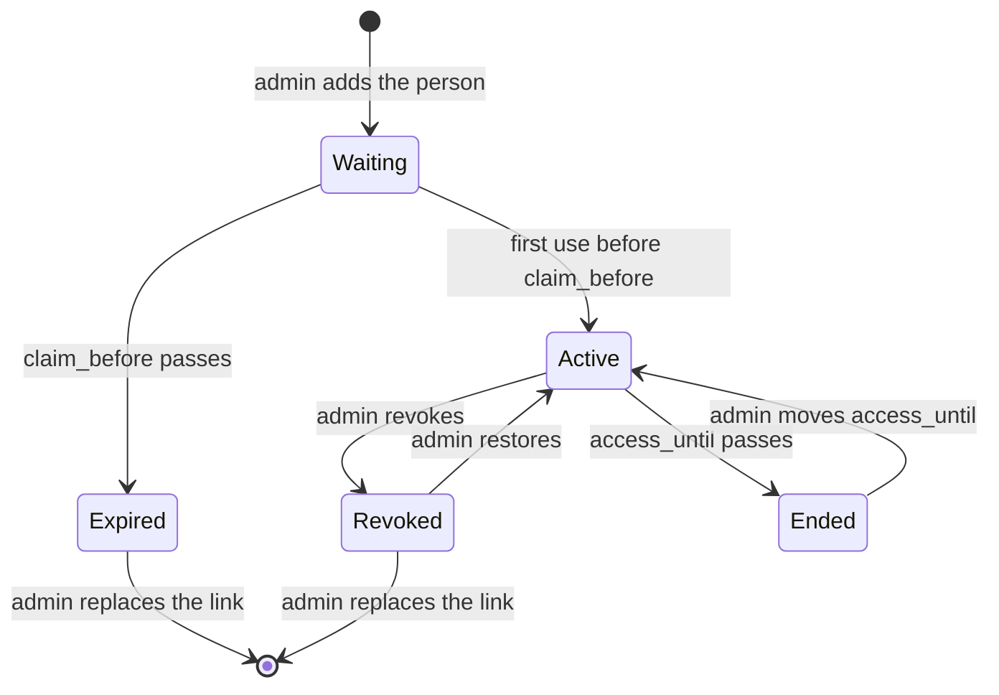

# Auth

Accounts, sign-in, and roles. Better Auth runs inside the API and handles passwords and sessions. FPR's own access keys decide who may get in.

## Better Auth

- Better Auth is served at `/api/auth/*`. It is built in `apps/api/src/auth.ts`.
- Email and password only. No OAuth and no public sign-up: Better Auth's sign-up endpoint is disabled.
- Sessions are HTTP-only, `Secure`, `SameSite=Lax` cookies on the instance's origin, named with the `__Secure-` prefix in every environment. A session lasts 30 days and is extended on use, at most once a day, with a renewed cookie.
- Better Auth's origin check accepts only `PUBLIC_URL`.
- Passwords are hashed with Better Auth's default hasher and are 12 to 128 characters long.
- A session starts only for a person whose access key gives access. A correct password for a person whose access ended answers `401` with the code `access_ended`. A wrong password answers the same whatever the person's access.
- Sign-in, setup, access-link checks, claims, and sign-ins, and password resets are rate-limited per client address. Password sign-in allows five attempts per address within a minute, then answers `429` for a minute. Better Auth reads the address from the `X-Forwarded-For` that `web` sets, and keeps the counts in memory. See Client address.
- A request to `/api/auth/*` without a client address, an `X-Forwarded-For` holding one IP address, is not rate-limited, and the first one since the API started is logged as an error. Clients never share one count.
- Better Auth's warnings and errors are pino lines of the API's logger.
- A signed-in person can change their password with their current one, through Better Auth's `/change-password`. A `before` hook in `apps/api/src/auth.ts` sets `revokeOtherSessions` on every request, so a change always ends the person's other sessions, and refuses anonymous viewers, who have no password, with `403` and `{ "code": "forbidden" }`.
- Better Auth writes `user`, `account`, `session`, and `verification`, with ids generated by Postgres. Better Auth's `name` and `image` are FPR's `display_name` and `avatar_key`, and FPR's other columns on `user` are Better Auth additional fields that no Better Auth endpoint accepts as input. See `database.md`.
- Better Auth's user-update endpoint is disabled: a person changes their profile through `PATCH /me`, and the admin through the admin area.

### Client address

Rate limits are kept per client address, the address of the person's device as the instance's edge sees it.

1. The host's reverse proxy reports the client's address in a header, `CLIENT_IP_HEADER`, by default `X-Forwarded-For`. Behind Cloudflare, it is `CF-Connecting-IP`, which Cloudflare sets on every request.
2. `web` takes the client's address from that header on requests from the loopback address and private networks (`127.0.0.0/8`, `10.0.0.0/8`, `172.16.0.0/12`, `192.168.0.0/16`, `::1`, `fc00::/7`), where the host's reverse proxy reaches it. With `X-Forwarded-For`, the client is the rightmost address outside these ranges. `web`'s access log shows that address as `remote_addr`.
3. `web` forwards it to the API as the only value of `X-Forwarded-For`, replacing anything the request came with. The API trusts that one hop: Express's `req.ip` and Better Auth's rate limits use it, and Better Auth stores it in `session.ip_address`.

`CLIENT_IP_HEADER` names only a header the edge proxy always sets, replacing any value the client sent: any other header lets a client choose its own address.

## Roles

| | Admin | Member | Guest | Anonymous |
| --- | --- | --- | --- | --- |
| Signs in with | Email and password | Email and password | Email and password | The access link |
| Has a portfolio and is ranked | Yes | Yes | No | No |
| Reads the race | Yes | Yes | Yes | Yes, anonymized |
| Edits own portfolio, cash, and profile | Yes | Yes | Profile only | No |
| Creates and edits manual shares and their value points | Yes | Yes | No | No |
| Edits any member's portfolio and cash | Yes | No | No | No |
| Reads the admin area | Yes | No | No | Yes, anonymized |
| Manages people and access | Yes | No | No | No |

The API enforces every cell of this table. The web app hides what a role can't use, and the API refuses it anyway. What anonymization replaces is in `api.md`.

Each route's contract declares who may call it: anyone, with `publicRoute`, or the roles it accepts, with `signedInRoute(roles)`. A route that declares neither fails to type-check and is refused with `403 forbidden`. The request pipeline's role guard checks the role, and refuses every write by an anonymous viewer. A write to one person's data, under `/users/:userId`, is checked by its handler, with `assertMayWriteUser`: the admin writes anyone's data, a member only their own. See `api.md`, Request pipeline.

## Access keys

An access key is a person's access, for as long as they have it. Every person, admins included, has exactly one key that gives access at a time.

- A key is 32 random bytes, encoded in base64url. Only its SHA-256 hash is stored, in hexadecimal, in `access_keys.code_hash`.
- The admin sees the key once, as a link: `<PUBLIC_URL>/access/<key>`.
- The key never stays in a URL: the web app sends it to the API in a request body, then removes it from the address bar and the browser history. Pages send no referrer, and `web` doesn't log `/access/` paths.
- A person has access when their key is claimed, not revoked, and not past `access_until`.

Replacing a link revokes the current key and creates a new one, waiting for first use, with the same `access_until`. The person has no access until they open the new link. A password user keeps their account and password.

### Every request

On every request to a route that isn't public, the API loads the session, then the person's key. With no key giving access, the API deletes every session of the person and answers `401` with the code `access_ended`. The web app shows "Your access has ended". The person's next request has no session and answers `unauthenticated`. See `api.md`, Request pipeline.

Better Auth's own endpoints run the same check, `authAccessCheck` in `apps/api/src/pipeline/access.ts`, before Better Auth: a request to `/api/auth/*` with a session cookie whose person has no key giving access deletes their sessions and answers `401` with `{ "error": { "code": "access_ended" } }`, on `get-session`, `change-password`, `list-sessions`, `revoke-session`, and every other endpoint. Sign-in and sign-out skip it: sign-in checks access when the session starts, and answers Better Auth's `{ "code": "access_ended" }`, and a cookie left by a person whose access ended never blocks another person's sign-in on the same browser.

## Flows

### Adding a person

1. The admin enters a display name, an email (not for an anonymous viewer), a role, and optionally an access end date.
2. The API creates the `user` row and an access key with `claim_before` 7 days ahead. An anonymous viewer gets a generated email, `<id>@anonymous.invalid`, never shown.
3. The admin copies the link and sends it however they like.

### First use, password users

1. The link opens `/access/<key>`. The API checks the key and returns the person's email and display name.
2. The person types a password, in one field they can reveal.
3. The API creates the `account` row through Better Auth's password hasher, sets `claimed_at`, and starts a session.

A key opened after `claim_before` shows that the link has expired. A key already claimed leads to the sign-in page. A key revoked by a replacement shows that the link was replaced, and to use the latest one.

A replaced link for a person who already has a password works the same way, without the password step: opening it claims the new key and leads to the sign-in page.

### Anonymous viewers

Anonymous viewers have no `account` row. Opening the link signs them in: the API checks that the key gives access, sets `claimed_at` on the first visit, and starts a session. The link works this way every time until access ends. Pasting the link on the sign-in page does the same, for an installed app that doesn't share the browser's session.

### Password reset

1. The admin generates a reset key for one person. It is shown once, valid 24 hours, and replaces any unused reset key of that person.
2. On `/reset-password`, the person enters their email and the reset key. A wrong pair gives one generic error.
3. On the next page, they type their new password.
4. The API sets the password, sets `used_at`, and deletes every session of that person.

Anonymous viewers have no password and no reset key.

### First admin

When no admin exists, `/setup` accepts the `ADMIN_BOOTSTRAP_KEY` environment variable's value, an email, a display name, and a password. The API creates the admin with a claimed access key and starts a session. Once an admin exists, `/setup` is closed whatever the key.

## Admin rules

- The last admin's access can't be revoked, ended, or replaced, and the last admin can't be deleted or change role.
- The admin can change a person's display name, email, role, and access end date. Roles move between admin, member, and guest. A person with portfolio entries can't become a guest. Nobody becomes or stops being anonymous.
- Revoking access, ending it, or deleting a person deletes their sessions at once.
- Restoring access clears `revoked_at`. The person signs in again with their password, or their link for an anonymous viewer.
