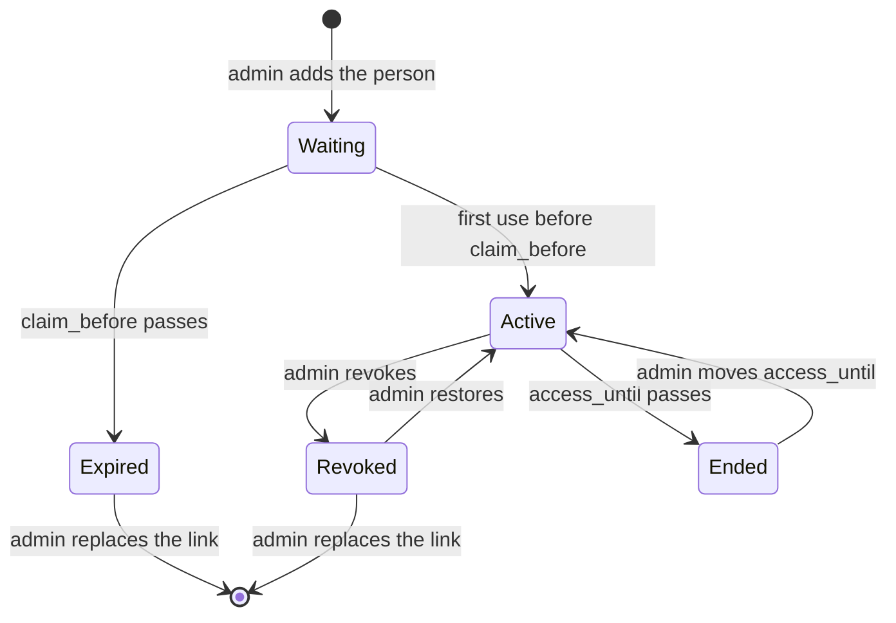

# Auth

Accounts, sign-in, and roles. Better Auth runs inside the API and handles passwords and sessions. FPR's own access keys decide who may get in.

## Better Auth

- Email and password only. No OAuth and no public sign-up: Better Auth's sign-up endpoint is disabled.
- Sessions are HTTP-only, `Secure`, `SameSite=Lax` cookies on the instance's origin. A session lasts 30 days and is extended on use.
- Better Auth's origin check accepts only `PUBLIC_URL`.
- Passwords are hashed with Better Auth's default hasher and are at least 12 characters long.
- Sign-in, access-link claims, and password resets are rate-limited per client address.
- A signed-in person can change their password with their current one. It ends their other sessions.
- Better Auth writes `user`, `account`, `session`, and `verification`. FPR's columns on `user` are declared as Better Auth additional fields. See `database.md`.

## Roles

|                                                        | Admin              | Member             | Guest              | Anonymous       |
| ------------------------------------------------------ | ------------------ | ------------------ | ------------------ | --------------- |
| Signs in with                                          | Email and password | Email and password | Email and password | The access link |
| Has a portfolio and is ranked                          | Yes                | Yes                | No                 | No              |
| Reads the race                                         | Yes                | Yes                | Yes                | Yes, anonymized |
| Edits own portfolio, cash, and profile                 | Yes                | Yes                | Profile only       | No              |
| Creates and edits manual shares and their value points | Yes                | Yes                | No                 | No              |
| Edits any member's portfolio and cash                  | Yes                | No                 | No                 | No              |
| Reads the admin area                                   | Yes                | No                 | No                 | Yes, anonymized |
| Manages people and access                              | Yes                | No                 | No                 | No              |

The API enforces every cell of this table. The web app hides what a role can't use, and the API refuses it anyway. What anonymization replaces is in `api.md`.

## Access keys

An access key is a person's access, for as long as they have it. Every person, admins included, has exactly one key that gives access at a time.

- A key is 32 random bytes, encoded in base64url. Only its SHA-256 hash is stored, in `access_keys.code_hash`.
- The admin sees the key once, as a link: `<PUBLIC_URL>/access/<key>`.
- The key never stays in a URL: the web app sends it to the API in a request body, then removes it from the address bar and the browser history. Pages send no referrer, and `web` doesn't log `/access/` paths.
- A person has access when their key is claimed, not revoked, and not past `access_until`.

Replacing a link revokes the current key and creates a new one, waiting for first use, with the same `access_until`. The person has no access until they open the new link. A password user keeps their account and password.

### Every request

On every authenticated request, the API loads the session, then the person's key. With no key giving access, the API deletes the person's sessions and answers `401` with the code `access_ended`. The web app shows "Your access has ended".

## Flows

### Adding a person

1. The admin enters a display name, an email (not for an anonymous viewer), a role, and optionally an access end date.
2. The API creates the `user` row and an access key with `claim_before` 7 days ahead. An anonymous viewer gets a generated email, `<id>@anonymous.invalid`, never shown.
3. The admin copies the link and sends it however they like.

### First use, password users

1. The link opens `/access/<key>`. The API checks the key and returns the person's email and display name.
2. The person types a password, in one field they can reveal.
3. The API creates the `account` row through Better Auth's password hasher, sets `claimed_at`, and starts a session.

A key opened after `claim_before` shows that the link has expired. A key already claimed leads to the sign-in page. A key revoked by a replacement shows that the link was replaced, and to use the latest one.

A replaced link for a person who already has a password works the same way, without the password step: opening it claims the new key and leads to the sign-in page.

### Anonymous viewers

Anonymous viewers have no `account` row. Opening the link signs them in: the API checks that the key gives access, sets `claimed_at` on the first visit, and starts a session. The link works this way every time until access ends. Pasting the link on the sign-in page does the same, for an installed app that doesn't share the browser's session.

### Password reset

1. The admin generates a reset key for one person. It is shown once, valid 24 hours, and replaces any unused reset key of that person.
2. On `/reset-password`, the person enters their email and the reset key. A wrong pair gives one generic error.
3. On the next page, they type their new password.
4. The API sets the password, sets `used_at`, and deletes every session of that person.

Anonymous viewers have no password and no reset key.

### First admin

When no admin exists, `/setup` accepts the `ADMIN_BOOTSTRAP_KEY` environment variable's value, an email, a display name, and a password. The API creates the admin with a claimed access key and starts a session. Once an admin exists, `/setup` is closed whatever the key.

## Admin rules

- The last admin's access can't be revoked, ended, or replaced, and the last admin can't be deleted or change role.
- The admin can change a person's display name, email, role, and access end date. Roles move between admin, member, and guest. A person with portfolio entries can't become a guest. Nobody becomes or stops being anonymous.
- Revoking access, ending it, or deleting a person deletes their sessions at once.
- Restoring access clears `revoked_at`. The person signs in again with their password, or their link for an anonymous viewer.
