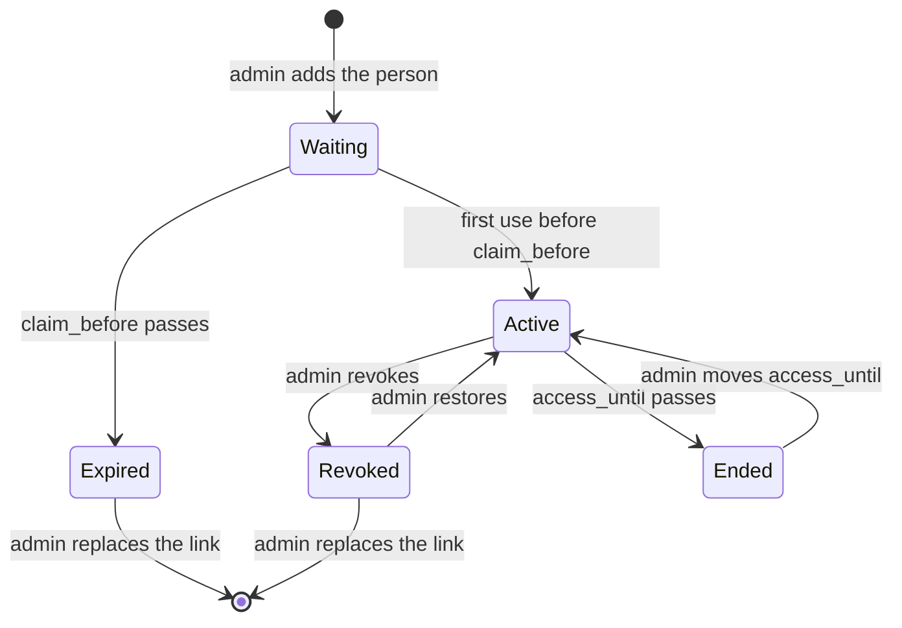

# Auth

Accounts, sign-in, and roles. Better Auth runs inside the API and handles passwords and sessions. FPR's own access keys decide who may get in. Each flow's cases, as people see them, are in `../product/user-stories.md`.

## Better Auth

- Served at `/api/auth/*`, built in `apps/api/src/auth/`. Email and password only: no OAuth, and its sign-up and user-update endpoints are disabled. A person changes their profile through `PATCH /me`, the admin through the admin area.
- Sessions are HTTP-only, `Secure`, `SameSite=Lax` cookies on the instance's origin, with the `__Secure-` prefix in every environment. A session lasts 30 days and is extended on use, at most once a day.
- It accepts writes from `PUBLIC_URL` alone.
- Passwords are 12 to 128 characters, hashed with Better Auth's default hasher. Changing one takes the current password and always ends the person's other sessions, whatever the request asks. Anonymous viewers have no password, and are refused with `403 forbidden`.
- A session starts only for a person whose access key gives access: a correct password for a person whose access ended is `401 access_ended`. A wrong password gets the same answer whatever the person's access.
- Setup, claims, and anonymous sign-ins start their session through a server-only endpoint of a Better Auth plugin, never reachable over HTTP, so the same cookie and access check apply.
- It writes `user`, `account`, `session`, and `verification`. FPR's own columns on `user` are additional fields no Better Auth endpoint accepts as input. See `database.md`.
- Its warnings and errors are lines of the API's logger.

## Rate limits

Sign-in, setup, the access link routes, and password reset are rate-limited per client address, with the counts kept in memory. Password sign-in allows five attempts per address within a minute, then answers `429` for a minute. Each public write allows five requests per address within a minute, then answers `429 rate_limited` with `Retry-After`. A request to `/api/auth/*` or a public write without a client address is not rate-limited, so clients never share one count, and the first one since the API started is logged as an error.

### Client address

The client address is the address of the person's device as the instance's edge sees it.

1. The host's reverse proxy reports it in the header `CLIENT_IP_HEADER` names, by default `X-Forwarded-For`. Behind Cloudflare, it is `CF-Connecting-IP`.
2. `web` reads that header only on requests from loopback and private networks (`127.0.0.0/8`, `10.0.0.0/8`, `172.16.0.0/12`, `192.168.0.0/16`, `::1`, `fc00::/7`), where the reverse proxy reaches it. With `X-Forwarded-For`, the client is the rightmost address outside those ranges. `web`'s access log shows it as `remote_addr`.
3. `web` sends it to the API as the only value of `X-Forwarded-For`, replacing anything the request carried. The API trusts that one hop: rate limits use it, and Better Auth stores it in `session.ip_address`.

`CLIENT_IP_HEADER` must name a header the edge proxy always sets, replacing any value the client sent. Any other header lets a client choose its own address.

## Roles

| | Admin | Member | Guest | Anonymous |
| --- | --- | --- | --- | --- |
| Signs in with | Email and password | Email and password | Email and password | The access link |
| Has a portfolio and is ranked | Yes | Yes | No | No |
| Reads the race | Yes | Yes | Yes | Yes, anonymized |
| Edits own portfolio, cash, and profile | Yes | Yes | Profile only | No |
| Creates and edits manual shares and their value points | Yes | Yes | No | No |
| Edits any member's portfolio and cash | Yes | No | No | No |
| Reads the admin area | Yes | No | No | Yes, anonymized |
| Manages people and access | Yes | No | No | No |

The API enforces every cell: each route's contract lists the roles it accepts, and the request pipeline refuses the rest (`api.md`, Request pipeline). The web app hides what a role can't use. What anonymization replaces is in `api.md`, Anonymization.

## Access keys

An access key is a person's access, for as long as they have it. Every person, admins included, has exactly one key that gives access at a time.

- A key is 32 random bytes in base64url. Only its SHA-256 hash is stored.
- The admin sees the key once, as a link: `<PUBLIC_URL>/access/<key>`.
- The key never stays in a URL: the web app sends it to the API in a request body, then removes it from the address bar and the history. Pages send no referrer, and `web` doesn't log `/access/` paths.
- A person has access while their key is claimed, not revoked, and not past `access_until`.

Replacing a link revokes the current key and creates a new waiting one with the same `access_until`. The person has no access until they open the new link. A password user keeps their account and password. A revoked key reads as `replaced` once its person has a newer key, and a key past `access_until` as `ended`, claimed or not.

Access is checked on every request to a route that isn't public, and on every Better Auth endpoint but sign-in and sign-out. Without a key giving access, every session of the person is deleted and the answer is `401 access_ended`. Sign-in checks access when the session starts, so a cookie left by a person whose access ended never blocks another person's sign-in on the same browser.

## Flows

### Adding a person

The admin enters a display name, an email, a role, and optionally an access end date. The API creates the person and a key to claim within 7 days, and the admin sends the link however they like. An anonymous viewer gets no email from the admin: the API gives them `<id>@anonymous.invalid`, never shown.

### First use, password users

The link opens `/access/<key>`. The API checks the key and returns the person's email and display name. The person types a password, and the API creates their `account`, marks the key claimed, and starts a session. A person who already has a password, after a replaced link, skips the password step: opening the link claims the new key and leads to sign-in. Two claims of one key at once claim it once.

### Anonymous viewers

Anonymous viewers have no `account` and no password. Opening the link signs them in: the API checks that the key gives access, marks it claimed on the first visit, and starts a session. The link works this way until access ends. Pasting it on the sign-in page does the same, for an installed app that doesn't share the browser's session.

### Password reset

1. The admin generates a reset key for one person. It is shown once, valid 24 hours, and replaces any unused reset key of that person.
2. The person enters their email and the reset key. A wrong pair, or an anonymous viewer's, gives one generic error.
3. They type their new password. The API sets it, marks the reset key used, and deletes every session of that person.

### First admin

While no admin exists, `/setup` accepts the value of `ADMIN_BOOTSTRAP_KEY` with an email, a display name, and a password, and creates the admin with a claimed key and a session. Once an admin exists, `/setup` is closed whatever the key, and two setups at once create one admin.

## Admin rules

- The admin changes a person's display name, email, role, and access end date.
- Roles move between admin, member, and guest. Nobody becomes or stops being anonymous. A person with portfolio entries can't become a guest.
- The last admin's access can't be revoked, ended, or replaced, and the last admin can't be deleted or change role.
- Revoking access, ending it, or deleting a person deletes their sessions at once.
- Restoring access clears the revocation. The person signs in again with their password, or their link for an anonymous viewer.
