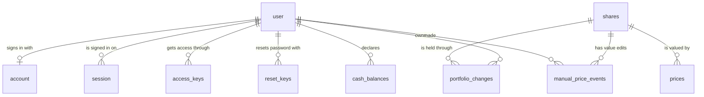

# Database

Postgres 18, reached by the API and the price service through one shared internal package, `@fpr/db`.

## Data access

`@fpr/db`, in `packages/db/`, is the only code that talks to Postgres. It is a library, not a service. It holds:

- **Connection**: one `pg` pool per process, configured from `DATABASE_URL`, behind a Kysely instance, with a ping for the health endpoints and a close that waits for running queries on shutdown.
- **Migrations** (`src/migrations/`): the one schema history for the whole system, Better Auth's tables included. Each migration is a file named `NNNN_description.ts`, numbered from `0001` and listed in `src/migrations/index.ts`. The API image runs the pending ones before the server starts, in name order and in one transaction, and refuses a migration that sorts before one already applied. A migration is never edited once it has run: a change is a new migration. Every migration stays compatible with the running code: additions ship first, removals in a later deploy.
- **Table types** (`src/tables/`): each table's row, insert, and update types, shared by every process.
- **Queries** (`src/queries/`): one module per table, holding that table's queries and no workflow logic.
- **Test databases** (`@fpr/db/testing`): each test file that touches the database creates its own migrated `fpr_test_…` database on the server at `DATABASE_URL`, and drops it afterwards.

`pnpm --filter @fpr/api auth:schema` prints the SQL that brings the database at `DATABASE_URL` to Better Auth's schema, as configured in `apps/api/src/auth/`, and nothing once it matches.

Identifiers are lowercase snake_case in SQL, Better Auth's columns included, and camelCase in TypeScript through Kysely's `CamelCasePlugin`. Every table carries `created_at`. The pool reads values as follows:

| Postgres | TypeScript |
| --- | --- |
| `numeric` | decimal `string`, never a floating-point number |
| `timestamptz` | `Date` |
| `date` | `YYYY-MM-DD` `string` |
| every other type | `pg`'s default |

## Keys and constraints

- Primary keys are `uuid` columns generated by Postgres with `uuidv7()`, which orders them by creation time, Better Auth's tables included. `prices` is keyed by (`share_id`, `at`).
- Every reference is a foreign key, and every foreign key column is indexed. What each does on delete: see Deletion.
- Columns with a fixed set of values are `text` with a `check` constraint listing them. Ranges, formats, and rules between columns are `check` constraints too, listed per table below.

## Writers

Each table has one writer. Every process can read any table.

| Table | Written by |
| --- | --- |
| `user`, `account`, `session`, `verification` | API, through Better Auth |
| `access_keys`, `reset_keys` | API |
| `portfolio_changes`, `cash_balances` | API |
| `shares`, `prices`, `manual_price_events` | Price service. A manual share or value a member enters reaches it through the API. |

## Schema

The migrations hold every column. Each table's purpose and the constraints that encode its rules:

### `user`

One row per person the admin added: Better Auth's table, extended. Better Auth's `name` and `image` are stored as `display_name` and `avatar_key`; `role`, `color`, `locale`, and `onboarded_at` are Better Auth additional fields that no Better Auth endpoint accepts as input.

- `email` is unique and stored in lowercase. An anonymous viewer has a generated address nobody sees. `email_verified` is always `false`.
- `role` is `admin`, `member`, `guest`, or `anonymous`. `display_name` is 1 to 40 characters. `color` is 1 to 10. `locale` is `fr` or `en`, and empty until the person picks one.
- `avatar_key` is the picture's object key in S3-compatible storage, empty for none. `onboarded_at` is empty until onboarding ends.

Pseudonyms are derived from the `id` and a server secret, and not stored (`api.md`).

### `account`, `session`, `verification`

Better Auth's. `account` holds the hashed password, created at the first use of an access key; anonymous viewers have none. `session` has one row per signed-in browser; revoking or ending a person's access, or resetting their password, deletes their rows. `verification` is Better Auth's internal token table, unused by FPR's keys.

### `access_keys`

A person's access, kept for as long as they have it. Only `code_hash` is stored: the key is shown to the admin once, as a link. `claim_before` defaults to 7 days after creation; `claimed_at`, `access_until` (empty for no end), and `revoked_at` complete the key's lifecycle. A partial unique index allows one key that is not revoked per person, so a person's current key is their latest. Who has access and when: `auth.md`.

### `reset_keys`

A one-time password reset for one person. Only `code_hash` is stored. A key works once, before `expires_at` (24 hours after creation by default), and while not revoked. A newer reset key for the same person revokes it.

### `shares`

One row per share a member looked up at the provider, and per manual share.

- `isin` is required and unique, whatever the provider: two uppercase letters, nine uppercase letters or digits, and a check digit. `name` is never empty.
- `kind` is `market` (priced by the provider) or `manual` (priced by value points members enter). A market share has a `provider_symbol` and an `exchange`, the one listing FPR prices, and a `trading_currency`, the three-letter code the provider quotes it in, such as `USD` or `GBX`. A manual share has none of them.
- The admin can turn a market share that needs attention into a manual one, never the reverse. Its prices stay.
- `history_starts_on` is the provider's earliest close, set when it starts after a holding (`prices.md` › History).
- `created_by` is the member who created a manual share.

### `portfolio_changes`

One row per change to a holding: "+3 of this share", "−2 of that one". `quantity_delta` is never zero and allows decimals for fund units. `effective_at` is never in the future, checked by the API. `created_by` is the member, or the admin editing on their behalf.

A holding at a moment is the sum of its changes up to and including that moment, and is never below zero. The API checks this on every create, edit, and delete, in a transaction holding an advisory lock on the person's changes, so two simultaneous writes cannot both pass. The view `current_positions` lists each person's holdings above zero: `user_id`, `share_id`, `quantity`.

### `cash_balances`

One row per cash declaration: "from this moment, I have €30". `amount_eur` is zero or more. Cash at a moment is the latest balance declared at or before it; of two at the same moment, the one recorded last counts.

### `prices`

What one unit of a share was worth at a moment, in EUR, one price per share and moment. `price_eur` is above zero. `source` is `close` (a daily close), `intraday` (from the 30-minute refresh), or `manual` (a member's value point). `entered_by`, the member who last entered or edited a value, is set only for `manual`.

A held market share has every daily close from its earliest holding onward, and intraday prices for the last 7 days; a market share nobody has held has none (`prices.md`). Manual shares are shared: any member and the admin can edit a manual share's name or ISIN and add, edit, or delete its value points. A manual share keeps at least one value point.

### `manual_price_events`

One row per value point added, edited, or deleted on a manual share: "Alex set Fund X to €40.10 for 3 March (was €41.00)". `action` is `added`, `edited`, or `deleted`. `price_eur` is set unless the action is `deleted`, `previous_price_eur` unless it is `added`. `user_id` is who made the change. Rows are never edited or deleted, except with their share or person.

## Indexes

Beyond the primary keys, the unique columns, and a single-column index on every other foreign key:

| Table | Index | Serves |
| --- | --- | --- |
| `verification` | `identifier` | Better Auth's token lookups |
| `access_keys` | `user_id`, unique, where `revoked_at` is empty | One key that is not revoked per person |
| `portfolio_changes` | (`user_id`, `share_id`, `effective_at`) | A holding at a moment, a person's log, the holding check |
| `portfolio_changes` | (`share_id`, `effective_at`) | A share's holders and markers, the deletion check |
| `cash_balances` | (`user_id`, `effective_at`) | Cash at a moment |
| `prices` | `at`, where `source = 'intraday'` | The daily deletion of old intraday prices |
| `manual_price_events` | (`share_id`, `at`) | A manual share's changes |

The primary key (`share_id`, `at`) of `prices` serves a share's latest price and its history.

## Valuation

- A share's value at a moment is its latest price at or before that moment.
- A balance at a moment is the sum of each holding × its value, plus cash. One euro of cash is always worth one euro.
- A day's balance is the balance at 23:59:59 in `RACE_TIMEZONE`, where the day's close is stored. Past days are valued at their close: the `close` price for a market share, the latest `manual` price for a manual share. Today is valued at the latest `intraday` price.
- Leaderboards use closes only, so a member who sells in the morning and buys in the afternoon is never ranked on the gap in between.
- A held market share with no price yet is pending, and its holder's balance is marked incomplete.
- A holding before a share's `history_starts_on` is valued at the share's earliest close.
- Leaderboards and balances are calculated from these tables, never stored.

## Deletion

Deleting a person deletes their `account`, `session`, `access_keys`, `reset_keys`, `portfolio_changes`, and `cash_balances` rows (`on delete cascade`). What they authored stays, with its author set to empty (`on delete set null`): `created_by` everywhere, `entered_by` on `prices`, and `user_id` on `manual_price_events`.

The admin deletes a share only when no `portfolio_changes` row refers to it: the foreign key refuses it otherwise (`on delete restrict`). Its `prices` and `manual_price_events` go with it.

## Retention

`close` and `manual` prices are kept forever. `intraday` prices are deleted after 7 days by the price service's daily run.
