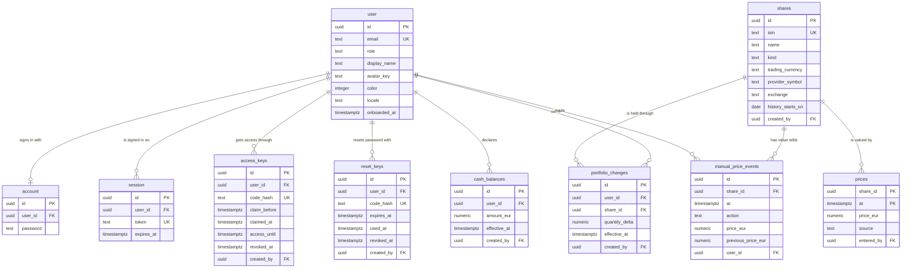

# Database

Postgres 18, accessed by the API and the price service through one shared internal package, `@fpr/db`.

## Data access

`@fpr/db` is the only code that talks to Postgres. It is a library, not a deployable service.

It holds:

- **Connection pool**: one `pg` pool per process, configured from `DATABASE_URL`, behind a Kysely instance. `createDb()` opens it, `ping()` runs `select 1` for the health endpoints, and `close()` waits for running queries and closes every connection on shutdown.
- **Migrations**: the one schema history for the whole system, run with Kysely's migrator by the API image before the server starts. Each migration is a file in `src/migrations/`, named `NNNN_description.ts` and numbered from `0001`, and listed in `src/migrations/index.ts`. `migrateToLatest()` runs the pending ones in name order, in one transaction, and refuses a migration that sorts before one already applied. A migration is never edited once it has run: a change is a new migration. Better Auth's tables are created by a migration in the same history, generated from Better Auth's schema in `apps/api/src/auth.ts`. `pnpm --filter @fpr/api auth:schema` prints the SQL that brings the database at `DATABASE_URL` to that schema, and nothing once it matches. Every migration stays compatible with the running code: additions ship first, removals in a later deploy.
- **Test databases**: `createTestDatabase()`, from `@fpr/db/testing`, creates a database named `fpr_test_…` on the Postgres server at `DATABASE_URL`, migrates it, and returns it with a `drop()` that removes it. Each test file that touches the database gets its own.
- **Row types**: one TypeScript type per table, used by every process that reads or writes it, in `src/tables/`. Each table's file exports the table, its selected row, its insert, and its update, such as `UserTable`, `User`, `NewUser`, and `UserUpdate`.
- **One query module per table**, built with Kysely, in `src/queries/`, exported as a namespace named after the table in the plural, such as `users.findById(db, id)`. A module holds the queries for its table and no workflow logic.

All identifiers are lowercase snake_case, including Better Auth's columns, which are mapped from its defaults. Every table carries `created_at`.

In TypeScript, tables and columns are camelCase: Kysely's `CamelCasePlugin` writes them in snake_case in SQL and returns rows in camelCase. The pool reads values as follows, with parsers set on the pool rather than on `pg`'s global registry:

| Postgres | TypeScript |
| --- | --- |
| `numeric` | decimal `string` |
| `timestamptz` | `Date` |
| `date` | `YYYY-MM-DD` `string` |
| every other type | `pg`'s default |

## Keys and constraints

- Primary keys are `uuid` columns generated by Postgres with `uuidv7()`, which orders them by creation time. Better Auth leaves id generation to Postgres. `prices` is the exception, keyed by share and moment.
- Foreign keys are declared on every reference. A person's own rows go with them (`on delete cascade`); `created_by`, `entered_by`, and the authorship `user_id` of `manual_price_events` are set to empty instead (`on delete set null`).
- Columns with a fixed set of values are `text` with a `check` constraint listing them: `role`, `locale`, `kind`, `source`, `action`. Ranges and lengths are `check` constraints too: `color` from 1 to 10, `display_name` from 1 to 40 characters, `quantity_delta` never zero, every price above zero.
- Formats are `check` constraints: a share's `isin` (two uppercase letters, nine uppercase letters or digits, and a check digit), its `trading_currency` (three uppercase letters), and its `name`, `provider_symbol`, and `exchange`, never empty strings.
- Rules between columns are `check` constraints: a market share has a `provider_symbol`, an `exchange`, and a `trading_currency`, and a manual share has none of them; a price has an `entered_by` only when its `source` is `manual`; a value edit has a `price_eur` unless it is a deletion, and a `previous_price_eur` unless it is an addition.
- A person holds at most one access key that is not revoked: a partial unique index on `access_keys`.
- Every foreign key column is indexed. A composite index whose first column is the foreign key counts.

## Writers

Each table has one writer. Every process can read any table.

| Table | Written by |
| --- | --- |
| `user`, `account`, `session`, `verification` | API, through Better Auth |
| `access_keys`, `reset_keys` | API |
| `portfolio_changes`, `cash_balances` | API |
| `shares`, `prices`, `manual_price_events` | Price service. A manual share or value entered by a member reaches it through the API. |

## Schema

### `user`

One row per person the admin added. Better Auth's table, extended with FPR's columns. Better Auth's `name` and `image` fields are stored in `display_name` and `avatar_key`, and `role`, `color`, `locale`, and `onboarded_at` are Better Auth additional fields that no Better Auth endpoint accepts as input.

- `email`: the sign-in name, in lowercase. Unique. For an anonymous viewer, a generated address nobody sees.
- `email_verified`: Better Auth's. Always `false`: FPR doesn't verify emails.
- `role`: `admin`, `member`, `guest`, or `anonymous`.
- `display_name`: the name shown on leaderboards. 1 to 40 characters.
- `avatar_key`: the uploaded picture's object key in S3-compatible storage. Empty means the person's initial on their colour.
- `color`: the person's colour, from 1 to 10. Set when the person is added, to the first colour nobody has. The API refuses a colour another person has, unless all ten are taken.
- `locale`: `fr` or `en`, once the person picks one in Settings. Empty until then, and the web app follows the browser's language.
- `onboarded_at`: when the person finished onboarding. Empty until then. Anonymous viewers get it when added.

A person's pseudonym and their picture as anonymous viewers see it are derived from their `id` and a server secret, and are not stored.

### `account`

Better Auth's credential row: the hashed password. Created when the person first uses their access key. Anonymous viewers have none.

### `session`

Better Auth's sessions, one row per signed-in browser. Revoking a person's access, ending it, or resetting their password deletes that person's rows.

### `verification`

Better Auth's internal token table. FPR's keys do not use it.

### `access_keys`

A person's access, kept for as long as they have it.

- `user_id`: the person it gives access to.
- `code_hash`: the hash of the key. The key itself is shown to the admin once, as a link, and never stored.
- `claim_before`: the deadline for the first use, 7 days after creation by default.
- `claimed_at`: the first use. For a password user, when they set their password. For an anonymous viewer, when they first opened the link.
- `access_until`: when access ends. Empty means no end.
- `revoked_at`: when the admin revoked it. Restoring access clears it.
- `created_by`: the admin who created it.

A person has access when they hold a key that is claimed, not revoked, and not past `access_until`. The API checks this on every request. An anonymous viewer signs in with the key itself, as many times as needed while it gives access. Replacing a lost link revokes the old key and creates a new one. A person holds at most one key that is not revoked, and their current key is their latest one.

### `reset_keys`

A one-time password reset for one person.

- `user_id`: the only person it can reset.
- `code_hash`: the hash of the key, shown to the admin once.
- `expires_at`: 24 hours after creation by default.
- `used_at`: when the person reset their password with it. A key is used once, and only before `expires_at` and while not revoked.
- `revoked_at`: when a newer reset key for the same person replaced it.
- `created_by`: the admin who created it.

### `shares`

One row per share a member has looked up at the provider, and per manual share. Only held market shares are priced: see `prices.md`.

- `isin`: unique and required. It identifies the share whatever the provider. Two uppercase letters, nine uppercase letters or digits, and a check digit.
- `name`: never empty.
- `kind`: `market` (priced by the provider) or `manual` (priced by value points members enter). The admin can turn a `market` share that needs attention into a `manual` one, never the reverse. Its prices stay.
- `trading_currency`: the currency the provider quotes the share in, a 3-letter uppercase code such as `USD` or `GBX`. The price service converts to EUR before storing. Required for market shares, and empty for manual shares, whose values are entered in EUR.
- `provider_symbol`, `exchange`: the one listing FPR prices, for a share traded on several exchanges. Required for market shares, empty for manual shares.
- `history_starts_on`: the date of the earliest close the provider has for the share, set when a history fetch finds nothing earlier. Empty until then. See `prices.md` › History.
- `created_by`: the member who created a manual share. Empty for market shares.

### `portfolio_changes`

One row per change to a holding: "+3 of this share" or "−2 of that one".

- `quantity_delta`: never zero. Decimals are allowed for fund units.
- `effective_at`: when the change happened. Never in the future.
- `created_by`: the member, or the admin when editing on their behalf.

A holding at a moment is the sum of its changes up to that moment, and is never negative. The API checks this on every create, edit, and delete, inside a transaction that locks the user's changes, so two simultaneous changes cannot both pass.

The view `current_positions` sums each user's changes per share and lists the holdings above zero.

### `cash_balances`

One row per cash declaration: "from this moment, I have €30".

- `amount_eur`: the cash held from `effective_at` onward.

Cash at a moment is the latest balance declared at or before it. Cash has no price: one euro is always worth one euro.

### `prices`

What one unit of a share was worth at a moment, in EUR. The key is (`share_id`, `at`): a share has one price per moment.

- `price_eur`: above zero.
- `source`: `close` (a daily closing price), `intraday` (a price from the 30-minute refresh), or `manual` (a value point entered by a member).
- `entered_by`: the member who last entered or edited a manual value. Empty for every other source.

Manual shares and their value points are shared: any member, and the admin, can edit a manual share's name or ISIN and add, edit, or delete its value points. A manual share keeps at least one value point.

A held market share has every daily close from its earliest holding onward, and intraday prices for the last 7 days. A market share nobody has held has no prices. See `prices.md`.

### `manual_price_events`

One row per value point added, edited, or deleted on a manual share. It records who changed which value and what it was before: "Alex set Fund X to €40.10 for 3 March (was €41.00)".

- `at`: the moment of the value point concerned.
- `action`: `added`, `edited`, or `deleted`.
- `price_eur`: the new value, above zero. Empty for a deletion, and only then.
- `previous_price_eur`: the value before, above zero. Empty for an addition, and only then.
- `user_id`: who made the change.

Rows are never edited or deleted, except with their share or person.

## Indexes

Beyond the primary keys and unique columns:

| Table | Index | Serves |
| --- | --- | --- |
| `account` | `user_id` | Better Auth's sign-in |
| `session` | `user_id` | Signing a person out everywhere |
| `verification` | `identifier` | Better Auth's token lookups |
| `access_keys`, `reset_keys` | `user_id`; `created_by` | A person's keys; deleting an admin |
| `access_keys` | `user_id`, unique, only where `revoked_at` is empty | One key that is not revoked per person |
| `shares` | `created_by` | Deleting a person |
| `portfolio_changes` | (`user_id`, `share_id`, `effective_at`) | A holding at a moment, a person's log, the holding check |
| `portfolio_changes` | (`share_id`, `effective_at`) | A share's holders and markers, the deletion check |
| `portfolio_changes` | `created_by` | Deleting a person |
| `cash_balances` | (`user_id`, `effective_at`) | Cash at a moment |
| `cash_balances` | `created_by` | Deleting a person |
| `prices` | `entered_by` | Deleting a person |
| `prices` | `at`, only where `source = 'intraday'` | The daily deletion of old intraday prices |
| `manual_price_events` | (`share_id`, `at`) | A manual share's changes |
| `manual_price_events` | `user_id` | Deleting a person |

The primary key (`share_id`, `at`) of `prices` serves a share's latest price and its history.

## Valuation

- A share's value at a moment is its latest price at or before that moment.
- A day's balance is the balance at the end of that day, 23:59:59 in `RACE_TIMEZONE`, where the day's close is stored.
- A balance at a moment is the sum of each holding × its value, plus cash.
- Past days are valued at their close: the `close` price for a market share, the latest `manual` price for a manual share. Today is valued at the latest `intraday` price.
- Leaderboards use closes only, so a member who removes shares in the morning and adds others in the afternoon is never ranked on the gap in between.
- A held market share with no price yet is pending, and its holder's balance is marked incomplete.
- A holding before a share's `history_starts_on` is valued at the share's earliest close.
- Leaderboards and balances are calculated from these tables and are not stored.

## Deletion

Deleting a person deletes their `account`, `session`, `access_keys`, `reset_keys`, `portfolio_changes`, and `cash_balances` rows. The shares they created, the prices they entered, and their `manual_price_events` stay, with `created_by`, `entered_by`, and `user_id` set to empty. Every other `created_by` pointing to them is set to empty too.

A share is deleted only by the admin, and only when no `portfolio_changes` row refers to it. Its `prices` and `manual_price_events` rows go with it.

## Retention

`close` and `manual` prices are kept forever. `intraday` prices are deleted after 7 days by the price service's daily run.
