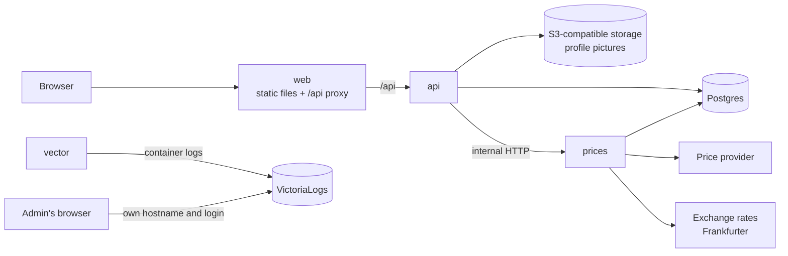

# Overview

FPR is a share-portfolio leaderboard. Members record the shares and cash they hold, and FPR ranks them on shared leaderboards and a race chart, valued at prices refreshed every 30 minutes during the trading day.

FPR is a generic, self-hostable tool. Every instance-specific value (domain, secrets, storage, price provider) comes from environment variables. Nothing in the code names an instance, its people, or their holdings.

## Blocks



| Block | What it is | File |
| --- | --- | --- |
| Web | The React app, served as static files and installable as a Progressive Web App. Its server also forwards `/api` to the API, so the browser sees one origin. | `web.md` |
| API | The only block the browser talks to. Accounts, access, portfolios, shares, leaderboards, and the admin area. | `api.md` |
| Price service | Internal. The only block that calls the price provider and the exchange-rate API, and the only writer of `shares`, `prices`, and `manual_price_events`. Prices the held shares on a schedule. | `prices.md` |
| Postgres | Every table, reached through the shared `@fpr/db` package. | `database.md` |
| Auth | Better Auth inside the API, FPR's access keys, reset keys, and roles. | `auth.md` |
| Deployment | Docker images, `compose.yaml`, configuration, CI. | `deployment.md` |

## Stack-wide conventions

- TypeScript everywhere, on Node 24.
- One pnpm workspaces monorepo. Biome lints and formats it, Vitest tests it, GitHub Actions runs both on every push.
- Git hooks, managed by lefthook and installed by `pnpm install`, run Biome on the staged files before each commit, fixing formatting and blocking on errors, and on the whole repository before each push.
- Every route is declared in `@fpr/contracts`: its method, path, Zod schemas, error codes, and accepted roles. The web app, the API, and the price service share these declarations, and the OpenAPI document is generated from them.
- Every process reaches Postgres through `@fpr/db`.
- Money is in euros. Prices are converted to EUR by the price service when fetched, and every amount stored is in EUR.
- Quantities, prices, and amounts are Postgres `numeric`, and travel as decimal strings in JSON, never as floating-point numbers. A decimal string is an optional minus sign, digits with no leading zero, and an optional fractional part, such as `74.328` or `-1250.00`: no plus sign, exponent, separator, whitespace, or negative zero.
- Days, weeks, and year-to-date start in the instance's time zone, `RACE_TIMEZONE`.

## Logging

`api` and `prices` log with pino: one JSON line per event on standard output. Vector collects every container's output and stores it in VictoriaLogs, which keeps it and serves a search interface on its own hostname, behind its own login. See `deployment.md`.

- Every line has the time, the level (`info`, `warn`, or `error`), the service, and a message.
- `api` logs every request with pino-http: a request id, the method, the route, the status, the duration, and the signed-in person's id. The response carries the same id in `X-Request-Id`.
- Every error is logged at `error` with its stack trace and its request id or price run.
- `prices` logs every run and every provider call. See `prices.md`.
- Passwords, access keys, reset keys, and session cookies are never logged: pino's `redact` removes them, and auth request bodies are not logged.
- In development, `pino-pretty` prints the lines readably.

## Repository

```
fpr/
├── apps/
│   ├── web/              # @fpr/web
│   ├── api/              # @fpr/api
│   └── prices/           # @fpr/prices
├── packages/
│   ├── contracts/        # @fpr/contracts: Zod schemas for the REST API
│   └── db/               # @fpr/db: pool, migrations, row types, queries
├── docs/
│   ├── architecture/
│   └── product/
├── compose.yaml
├── .env.example
├── package.json
├── pnpm-workspace.yaml
├── tsconfig.base.json
├── biome.json
├── lefthook.yml
├── vitest.config.ts
├── vitest.shared.ts
└── .nvmrc
```

- Every workspace is named `@fpr/<folder>`.
- The root `package.json` pins pnpm through `packageManager` and Node 24 through `engines`. `.nvmrc` holds `24`.
- Every dependency is pinned to an exact version. `pnpm-workspace.yaml` sets `saveExact`, so `pnpm add` writes exact versions.
- Each workspace's `tsconfig.json` extends `tsconfig.base.json`.
- `vitest.config.ts` makes each workspace a Vitest project, named after its package. Each workspace's `vitest.config.ts` merges `vitest.shared.ts`, which resolves the `@fpr/source` condition. `pnpm test` runs every project, and `pnpm test --project @fpr/<folder>` runs one.
- Packages build to `dist/`. Their `@fpr/source` export condition points at `src/`, which development tooling resolves, so a package edit reaches its consumers without a rebuild.
- Each app has its own `apps/<name>/Dockerfile`, built from the repository root with `pnpm deploy`.

## First version

The first version covers every `v1` story in `../product/user-stories.md`. The `later` stories are the event feed, the best-pick leaderboard, personal records, and bank statement import. A new leaderboard is a new query on the same series: see `api.md`.
