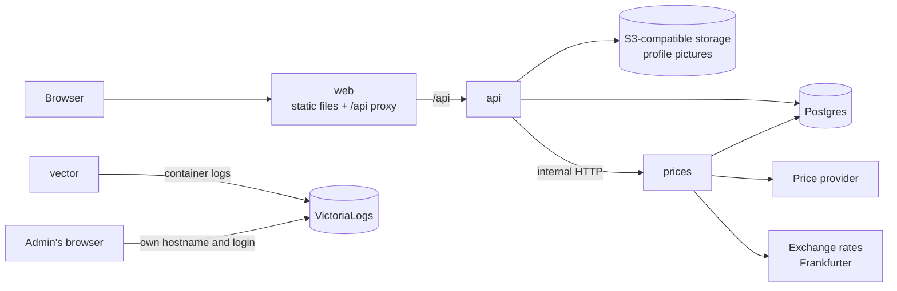

# Overview

FPR is a share-portfolio leaderboard. Members record the shares and cash they hold, and FPR ranks them on shared leaderboards and a race chart, valued at prices refreshed every 30 minutes during the trading day.

FPR is a generic, self-hostable tool. Every instance-specific value (domain, secrets, storage, price provider) comes from environment variables. Nothing in the code names an instance, its people, or their holdings.

## Blocks



| Block | What it is | Its doc covers |
| --- | --- | --- |
| Web | The React app, served as static files and installable. Its server forwards `/api` to the API, so the browser sees one origin. | `web.md`: stack, design tokens, screens, languages, serving |
| API | The only block the browser talks to: accounts, portfolios, shares, leaderboards, and the admin area. | `api.md`: route contracts, request pipeline, errors, routes, race calculation, anonymization |
| Price service | Internal. The only block that calls the price provider and the exchange-rate API, and the only writer of shares, prices, and manual price events. | `prices.md`: provider, schedule, call budget, currency, endpoints |
| Postgres | Every table, reached through the shared `@fpr/db` package. | `database.md`: schema, writers, valuation, deletion, retention |
| Auth | Better Auth inside the API, FPR's access keys, and roles. | `auth.md`: roles, access keys, sign-in flows, rate limits, admin rules |
| Deployment | Docker images, `compose.yaml`, configuration, logs, backups, CI. | `deployment.md` |

## Stack-wide conventions

- TypeScript on Node 24, in one pnpm workspaces monorepo. Biome lints and formats, Vitest tests, and GitHub Actions runs both on every push. lefthook runs Biome on staged files before each commit and on the whole repository before each push.
- Every route is an oRPC contract in `@fpr/contracts`, shared by the web app, the API, and the price service. The OpenAPI document is generated from them. See `api.md`, Route contracts.
- Every process reaches Postgres through `@fpr/db`.
- Money is in euros. The price service converts prices to EUR when it fetches them, and every amount stored is in EUR.
- Quantities, prices, and amounts are Postgres `numeric` and travel in JSON as decimal strings, never floating-point numbers. A decimal string is an optional minus sign, digits with no leading zero, and an optional fractional part, such as `74.328` or `-1250.00`: no plus sign, exponent, separator, whitespace, or negative zero. One a person enters has at most 12 digits before the point and 8 after. Arithmetic on them happens in Postgres or with `big.js`.
- Days, weeks, and year-to-date start in the instance's time zone, `RACE_TIMEZONE`.
- Tests are integration tests in each workspace's `test/`: the API and the price service over HTTP, with one file per API route in `test/routes/`; sign-in and access; the database's rules against a real Postgres; guards over every contract route; and the locales. Components are checked by their stories, run in Chromium.

## Logging

- `api` and `prices` log with pino, one JSON line per event on standard output, each with the time, the level, the service, and a message. In development, `pino-pretty` prints them readably.
- `api` logs every request with a request id, the method, the route, the status, the duration, and the signed-in person's id, and returns the id in `X-Request-Id`. `web`'s nginx writes one JSON access line per request, carrying the same id for requests proxied to `api`.
- An unexpected failure is logged at `error` with its stack and its request id or price run. A refusal with a declared error code, `400 invalid_request` included, is logged at `info` with its code and request id, and an invalid request's issue paths, never its values.
- Passwords, access keys, reset keys, and session cookies are never logged.

Vector collects every container's output into VictoriaLogs: see `deployment.md`, Logs.

## Repository

```
fpr/
├── apps/
│   ├── web/              # @fpr/web
│   ├── api/              # @fpr/api
│   └── prices/           # @fpr/prices
├── packages/
│   ├── contracts/        # @fpr/contracts: route contracts, with /prices and /openapi
│   └── db/               # @fpr/db: pool, migrations, row types, queries
├── deploy/               # the vector and backup images
├── docs/
│   ├── architecture/
│   └── product/
├── compose.yaml
├── compose.dev.yaml      # local ports for development
├── .env.example
├── tsconfig.base.json
├── vitest.config.ts
└── vitest.shared.ts
```

- Every workspace is named `@fpr/<folder>`. Each app has its own `Dockerfile`, built from the repository root with `pnpm deploy`.
- Node 24 is pinned in `package.json` and `.nvmrc`, pnpm through `packageManager`. Every dependency is pinned to an exact version.
- Each workspace's TypeScript configuration extends `tsconfig.base.json`.
- `pnpm test` runs every workspace as a Vitest project, and `pnpm test --project @fpr/<folder>` runs one.
- Packages build to `dist/`. Their `@fpr/source` export condition points at `src/`, which development tooling resolves, so a package edit reaches its consumers without a rebuild.

## First version

The first version covers every `v1` story in `../product/user-stories.md`. The `later` stories are the event feed, the best-pick leaderboard, personal records, and bank statement import.
